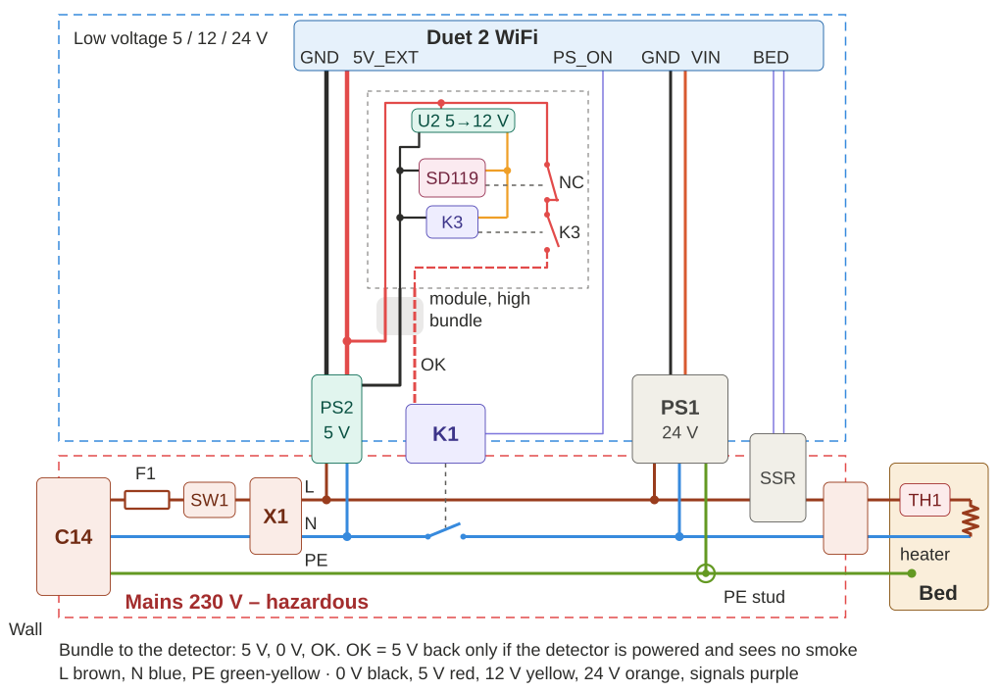

# Printer power safety

Mains (230 V) power and safety circuit for a 3D printer with a Duet 2 WiFi controller and a 230 V bed heater
switched by an SSR. Starting from the bare circuit (**Firestarter**), each stage adds one protection, up to
**Paranoid**. Each stage explains why the protection is needed and how well it protects.



| Stage | Name | Adds | Rating |
|---|---|---|---|
| A0 | Firestarter | inlet, 1-pole switch, Wago, PSU 24 V, SSR, bed heater, Duet | ☆☆☆☆☆ |
| A1 | 24+ThermalCut | thermal cutoff on the bed, in series with the heater | ★★☆☆☆ |
| A2 | 24+ThermalCut+Fuse | mains fuse | ★★☆☆☆ |
| A3 | 24+Relay | relay in N, Duet PS_ON, START at 230 V (inlet at the front only) | ★★★☆☆ |
| A4 | 24/5 | 5 V standby PSU, Duet on standby, only low voltage at the front | ★★★☆☆ |
| A5 | 24/5+Smoke | smoke detector module with supply supervision, 3-wire bundle | ★★★★☆ |
| A6 | 24/5+Smoke+Nano | Nano supervisor: heartbeat watchdog, latch, diagnostics | ★★★★☆ |
| A7 | Paranoid *(planned)* | second relay in L, hardware START/STOP latch | ★★★★★ |

- **Stages, sketches, effectiveness table:** [docs/stages.md](docs/stages.md)

## Files

- `docs/sketches/*.svg` – stage sketches, generated by `tools/sketches.py`.
- `kicad/steps/<code>_*.kicad_pro` – every stage A0–A6 as its own small KiCad project, drawn like the sketches
  (mains at the bottom, wire colours as bought). Previews and BOM per stage: [docs/steps.md](docs/steps.md),
  [docs/bom.md](docs/bom.md).
- `kicad/printer_power_safety.kicad_pro` – the most complete drawn stage (A6). Open this in KiCad 10.
- `kicad/safety.kicad_sym` – project symbols: split relay (coil / contact units), smoke detector, step-up module,
  2-pole bed plug, Duet 2 block.
- `tools/gen_power.py` – generates all schematics and the docs from `tools/steps_text.py`.
  `tools/render.py` runs ERC and exports the PNG previews (Windows: KiCad CLI + headless Edge + Pillow).

```
python tools/gen_power.py
python tools/render.py
```

The schematics are generated: edit the generator (or edit in KiCad and stop regenerating that file).

## Status

Design study – **not built, not tested on hardware**. ERC: A0–A3 clean; A4–A6 report one expected error (the 0 V outputs of PS1 and PS2 are
joined into the common 0 V, two power outputs on one net).
Before building, check against the Duet 2 documentation:
- powering the Duet from 5 V standby through 5V_EXT (internal 5 V jumper);
- which pin provides PS_ON or a GPIO for `M80`/`M81 C"…"`, and its voltage.

Also check the SD119 relay behaviour (NC closed when unpowered, open when the head is removed) on the real detector.

**Mains voltage can kill.** The 230 V side must be built and checked by a qualified person.
