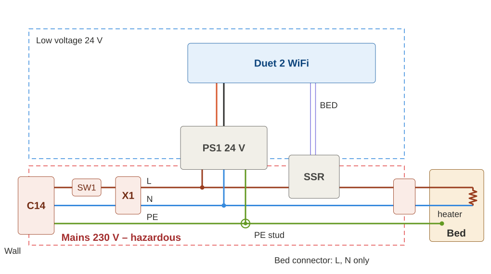
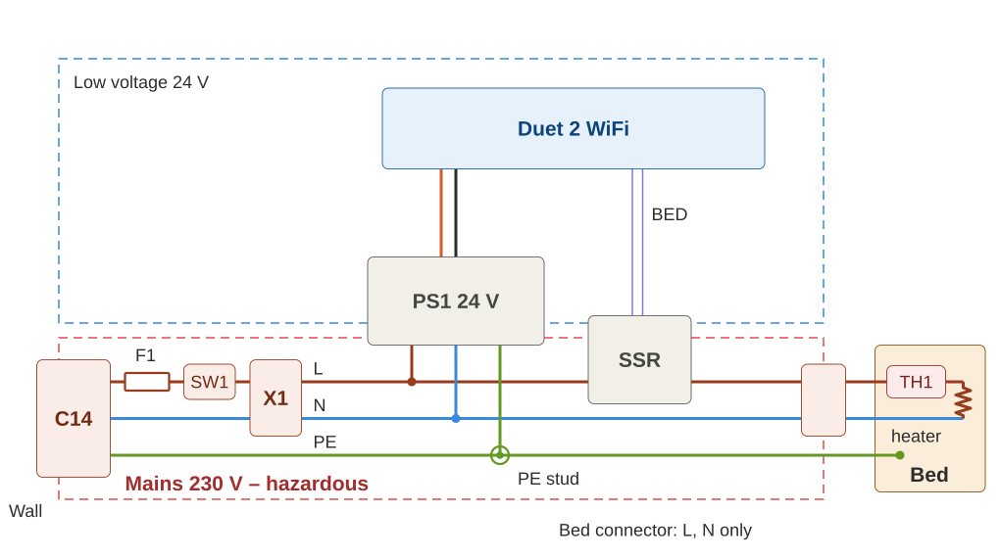
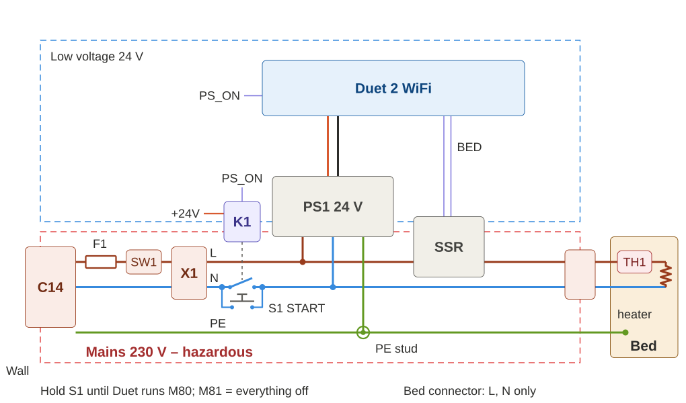
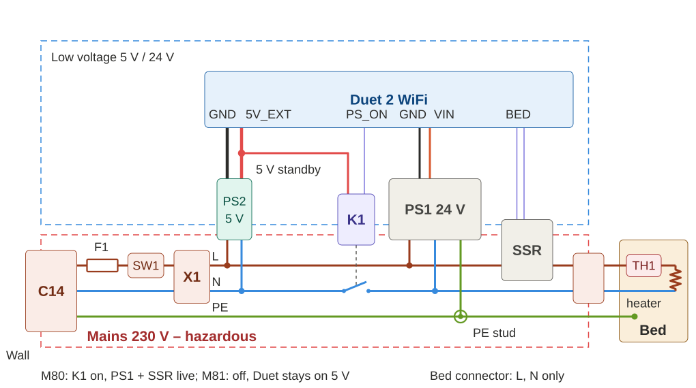
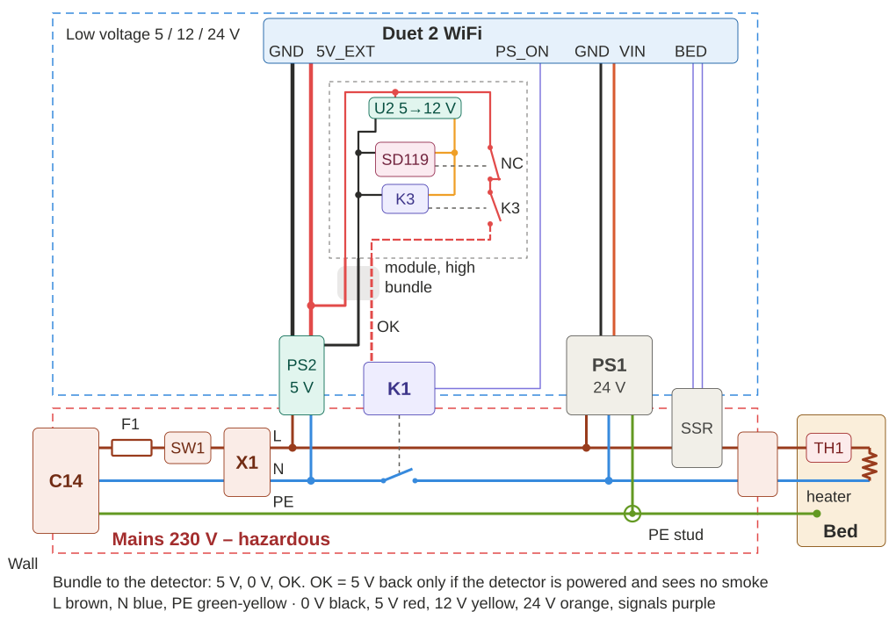
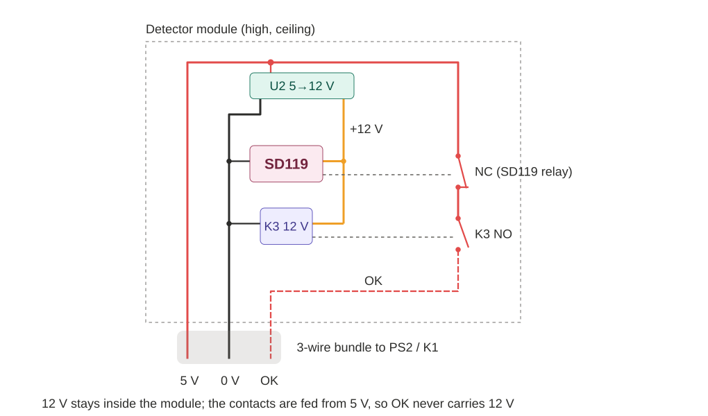
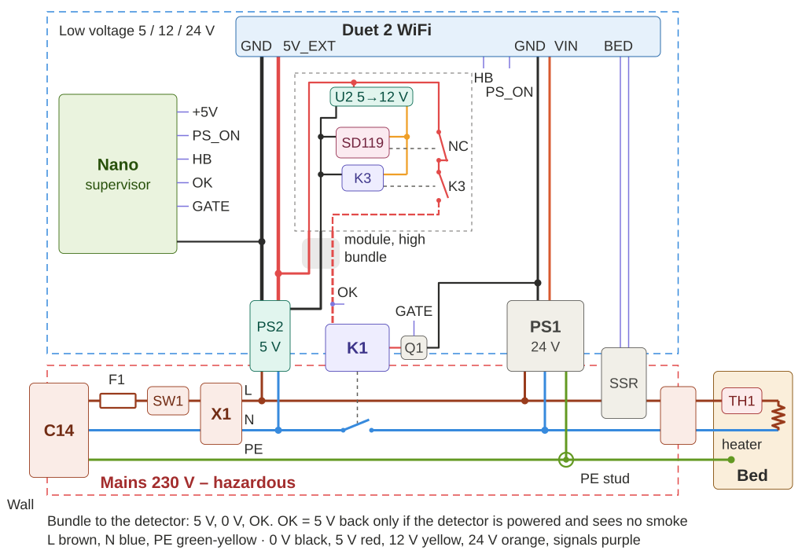

# SmokePowerLatch – stages: how the idea evolved

A 3D printer with a Duet 2 WiFi controller, a 24 V PSU and a 230 V bed heater switched by an SSR.
Starting from the bare circuit (**Firestarter**), each stage adds one protection. The last one is
**Paranoid**. Every stage is a complete, buildable circuit.

**Status:** design study – not built, not tested on hardware. **Mains voltage can kill:** the 230 V side
must be built and checked by a qualified person.

## How to read the sketches

- **Layout:** mains 230 V at the bottom, low voltage above. The L, N and PE rails run left to right in
  the order the wires really go: inlet, fuse, switch, Wago block X1, then the loads. Parts that straddle
  the dashed boundary (PSUs, SSR, relay coils) have their mains side down and their low-voltage side up.
- **Wiring:** lines are drawn straight; DC and signal lines run vertically to the Duet. A grey band marks a
  cable bundle. A dashed thin line from a coil to a contact is the mechanical link of a relay.
- **Wire colours (as bought):** L brown, N blue, PE green-yellow · 0 V black, 5 V red, 12 V yellow,
  24 V orange, signals purple.

## Stages and how well they protect

✓ protects · ~ partly · ✗ does not. The rating is for fire protection of the whole printer, not for
the quality of a single part.

| Stage | Name | Shorted SSR | Short circuit | Fire from another cause | Hung Duet | Power comes back after a trip | Rating |
|---|---|---|---|---|---|---|---|
| A0 | Firestarter | ✗ | ~ house breaker only | ✗ | ✗ | – | ☆☆☆☆☆ |
| A1 | 24+ThermalCut | ✓ cutoff on the bed | ~ | ✗ | ~ bed only | ~ bimetal resets | ★★☆☆☆ |
| A2 | 24+ThermalCut+Fuse | ✓ | ✓ F1 | ✗ | ~ bed only | ~ | ★★☆☆☆ |
| A3 | 24+Relay | ✓✓ cutoff + `M81` | ✓ | ✗ | ✗ PS_ON stays on | ✓ START by hand | ★★★☆☆ |
| A4 | 24/5 | ✓✓ | ✓ | ✗ | ✗ | ~ `M80` at boot restarts | ★★★☆☆ |
| A5 | 24/5+Smoke | ✓✓ | ✓ | ✓ in hardware | ✗ until smoke | ~ detector auto-reset | ★★★★☆ |
| A6 | 24/5+Smoke+Nano | ✓✓✓ + watchdog | ✓ | ✓ | ✓ heartbeat | ✓ latched in the Nano | ★★★★☆ |
| A7 | Paranoid *(planned)* | ✓✓✓ | ✓ | ✓ | ✓ | ✓ hardware latch | ★★★★★ |

---

## A0 – Firestarter

The bare working circuit: C14 inlet, 1-pole switch SW1, Wago block X1, 24 V PSU, Duet, SSR, 230 V bed heater.
PE goes from the inlet to the PE stud on the case, where the PSU earth and a separate PE wire to the bed
plate are bolted. The bed connector carries only L and N; PE bypasses it.

**What can go wrong**
- **The SSR fails shorted.** This is the most common SSR failure, frequent with counterfeit SSR-25DA. The bed
  then heats at full power without end. Duet thermal-runaway detection can only switch the SSR input off,
  which does nothing to a shorted SSR.
- **No fuse:** the house breaker (B16) protects the building wiring, not the thin wires inside the printer.
- **No automatic cut-off, no emergency stop, no fire detection.**
- **Reversible Schuko plug + 1-pole switch:** with the plug reversed, the switch breaks N and everything
  stays live when “off”. Use a 2-pole SW1 – see [Breaking one pole or both](#breaking-one-pole-or-both-sw1-k1-and-k2).

## A1 – 24+ThermalCut

**Adds:** thermal cutoff TH1 (KSD301 NC 130 °C, 250 V / 10 A) on the bed, in series with the heater, right
at the bed connector.

**Why first:** a shorted SSR is the most likely way this printer starts a fire. The cutoff opens by physics,
with no firmware and no SSR involved. It is one cheap part.

- Mount it on the aluminium plate with a screw and thermal paste, close to the heater, not hanging on its
  wires. Use silicone wire between the connector and TH1.
- Cutoff temperature ≈ 15–20 °C above the highest bed set-point.
- A **bimetal** resets when cool: with a shorted SSR the bed cycles around 130 °C instead of running away.
  A one-shot **thermal fuse** latches off and must be replaced.

**Limits:** it protects the bed only.

## A2 – 24+ThermalCut+Fuse

**Adds:** slow-blow fuse F1 in L, right after the inlet. In practice this is the fuse drawer of a C14 inlet
module, which is replaceable from outside.

**Why:** a short inside the printer (a chafed heater cable, a failed PSU input) can burn thin wires before
the house breaker trips. Size: (bed W + PSU W / 0.85) / 230 V × 1.25, e.g. 750 W + 350 W → T6.3A.

**Limits:** it does nothing against overheating at normal current, such as a stuck SSR.

## A3 – 24+Relay

**Adds:** relay K1 in N, with a 24 V coil switched by Duet PS_ON. A START push button S1 sits in parallel with
the K1 contact.

**How it works:** hold START, PS1 powers up, Duet boots and runs `M80`, K1 pulls in, release. `M81` (for
example from `heater-fault.g` on thermal runaway) drops K1, and the printer switches off completely. After a
power cut it stays off.

**Why:** this is the first stage that can remove 230 V from the PSU and the SSR, including automatically
when Duet detects a thermal runaway. This also covers a shorted SSR.

**When to use it:** only when the inlet and the switch are at the front of the printer. START is at 230 V and
carries the full inrush current, so a 230 V cable must not run through the printer to a front panel.

**Limits:**
- A hung Duet with PS_ON active keeps the power on.
- The contact is in N only. Depending on plug orientation, L can stay on the loads when off, which matters
  during service.

## A4 – 24/5

**Adds:** 5 V standby PSU PS2, fed before K1 so it is always on. PS2 powers the Duet through 5V_EXT and the
5 V coil of K1; Duet PS_ON switches the coil low side. The START button at 230 V is gone, so only low voltage
reaches the front of the printer.

**How it works:** Duet runs on standby. `M80` switches PS1 and the SSR on, `M81` switches them off.

**Why:** protection is the same as A3, but the build is safer, with no 230 V on the front panel. It is the
base for every later stage.

**Limits:**
- With `M80` in `config.g`, power comes back by itself after a power cut.
- A hung Duet still keeps the power on.

**Check before wiring:** the Duet 2 5V_EXT input and the internal 5 V jumper, and the PS_ON pin type and
current. It is meant for an ATX PSU and must only ever see 5 V or less.

## A5 – 24/5+Smoke

**Adds:** smoke detector SD119 with supply supervision relay K3, as one module mounted high in the enclosure
(see below). A 3-wire bundle (5 V, 0 V, OK) runs down and splits at PS2: 5 V and 0 V go to PS2, and OK goes
to the K1 coil.

**Why:** TH1 watches only the bed. A fire can also start in the PSU, the wiring, the SSR, the hot end or
the filament. The detector reacts to all of them and drops K1 in hardware, without the Duet.

| Fault | Result |
|---|---|
| Smoke | NC opens → OK dead → K1 off |
| Detector loses 12 V (step-up, wire) | K3 drops → K1 off |
| Any of the 3 bundle wires broken | K1 off |
| Detector head removed from its base | C–NC opens → K1 off *(check on your SD119)* |

**Limits:**
- The SD119 resets by itself when the smoke clears. K1 then comes back if PS_ON is still active, so add a
  latch, either `M81` in the Duet when VIN disappears or the hardware latch of A7.
- A powered detector with a dead sensor is not detected. Press TEST regularly; the printer must switch off.
- A short between the 5 V and OK wires bypasses the detector. Use sheathed cable away from sharp edges
  and moving parts.

### Detector module

- **Inputs from the bundle:** 5 V and 0 V. The step-up U2 makes 12 V for the SD119 and for the K3 coil,
  both connected in parallel across the same 12 V and 0 V.
- **Supervision:** K3 sits at the detector, so it sees the voltage the detector really gets, and any broken
  supply wire drops it.
- **Contact chain:** SD119 NC and K3 NO in series, fed from **5 V**. OK therefore returns 5 V, never 12 V,
  and the Duet PS_ON pin never sees more than 5 V.
- **Step-up grounds:** IN− and OUT− of a non-isolated step-up (MT3608, XL6009) are the same copper. Connect
  both: IN− to the bundle 0 V, OUT− to the module 0 V rail.
- **SD119 setting:** set the relay output to NC and check that NC is closed when the detector is unpowered.
  That closed-when-unpowered behaviour is why K3 is needed.

## A6 – 24/5+Smoke+Nano

**Adds:** an Arduino Nano supervisor on 5 V standby, with MOSFET Q1 on the low side of the K1 coil. Duet PS_ON
and a heartbeat HB (toggled by `daemon.g`) go to the Nano instead of the coil, and the Nano also reads OK.

**Logic:** GATE is on only if PS_ON is active **and** HB is fresh (< 5 s). If HB stops or OK drops, the Nano
switches off and stays off until it is reset, so there is no automatic restart after the smoke clears.

**Why:** it closes the two gaps of A5, a hung Duet and the detector auto-reset, and it can tell what tripped.
The detector still cuts K1 in hardware even with a dead Nano, because the contacts are in series with the
coil. A pull-down on the Q1 gate keeps K1 off when the Nano is not driving it.

**Limits:**
- The latch is in software.
- A welded K1 contact is not detected.
- L stays on the loads after switching off.

**To add in the detailed design:** a flyback diode on the K1 coil, a gate resistor and pull-down for Q1, a
pull-down on the OK input, and a diode into the Nano 5 V pin against back-feeding from USB.

## Breaking one pole or both: SW1, K1 and K2

**There is no fixed L and N inside the printer.** Schuko and Polish (type E) sockets are not polarised:
the plug fits both ways, and even the two sockets of one double outlet can be wired in opposite order. The
"L" and "N" on the schematics are only wire names. Wherever SW1 or K1 breaks one wire, the phase may be on
the other one.

What breaking a single pole does and does not do:

| Situation | One pole open | Both poles open |
|---|---|---|
| Normal load current (PSU, bed heater) | stops – the circuit is open, whichever wire carries the phase | stops |
| A burning PSU with a fault from the phase to PE | can still flow if the unbroken wire is the phase; only the house RCD or breaker helps | stops |
| Touching parts during service, printer "off" | 230 V to earth on the loads in about half of the cases | safe |

So a single pole is enough to stop the energy that feeds a fire in normal operation, but it is not an
isolating switch.

**Recommendation – SW1 2-pole at every stage.** It is a cheap part (a 2-pole rocker or a C14 inlet module
with a 2-pole switch), and with it "off" really means off. In the schematics SW1 is drawn as a 1-pole
switch; build it as 2-pole. K1 in one wire then stays the fire cut-off, SW1 is the isolating switch.

**Next step – K1 and K2 on two separate relays (A7).** K1 breaks one wire, K2 the other, both coils driven
by the same OK chain, so smoke or a broken bundle wire opens both poles.

- **Why two relays, not one 2-pole relay:** a welded contact is the most likely failure of a mains relay,
  helped by the inrush current of the 24 V PSU. In a 2-pole relay one welded contact holds the armature,
  and the armature usually holds the second contact closed too, so one weld defeats both poles. With two
  independent relays a welded K1 still leaves K2 opening: the load current stops and the fire cut-off still
  works.
- **What two relays do not cover:** the common drive. If whatever holds the coils fails "on" (a welded K3
  contact, a shorted Q1 in A6, a stuck START), both relays stay closed.
- **A weld is silent:** a welded K1 shows nothing until there is smoke. Test regularly: with the printer on,
  press TEST on the detector – both relays must drop. Relays with forcibly guided contacts (EN 61810-3) and
  a mirror NC contact in series with START would block the next start after a weld; this is an option for
  later, these relays are usually rated 6–8 A.
- Choose relays rated for the PSU inrush (AgSnO₂ contacts, 16 A class).

## A7 – Paranoid *(planned)*

**Will add:**
- relay K2 in the other wire, as an independent relay (see above): no phase is left on the loads after a
  trip, and a welded K1 does not defeat the cut-off;
- SW1 as a 2-pole switch in the drawing;
- a hardware START/STOP latch: an NC mushroom STOP in the 5 V chain, and a START button with a hold contact
  (small relay K4 in parallel with K1).

With these, every trip stays latched in hardware. What is left is a dead detector sensor, which only the
regular TEST catches.

---

Sketches are generated by [`tools/sketches.py`](../tools/sketches.py) (`python tools/sketches.py`).
