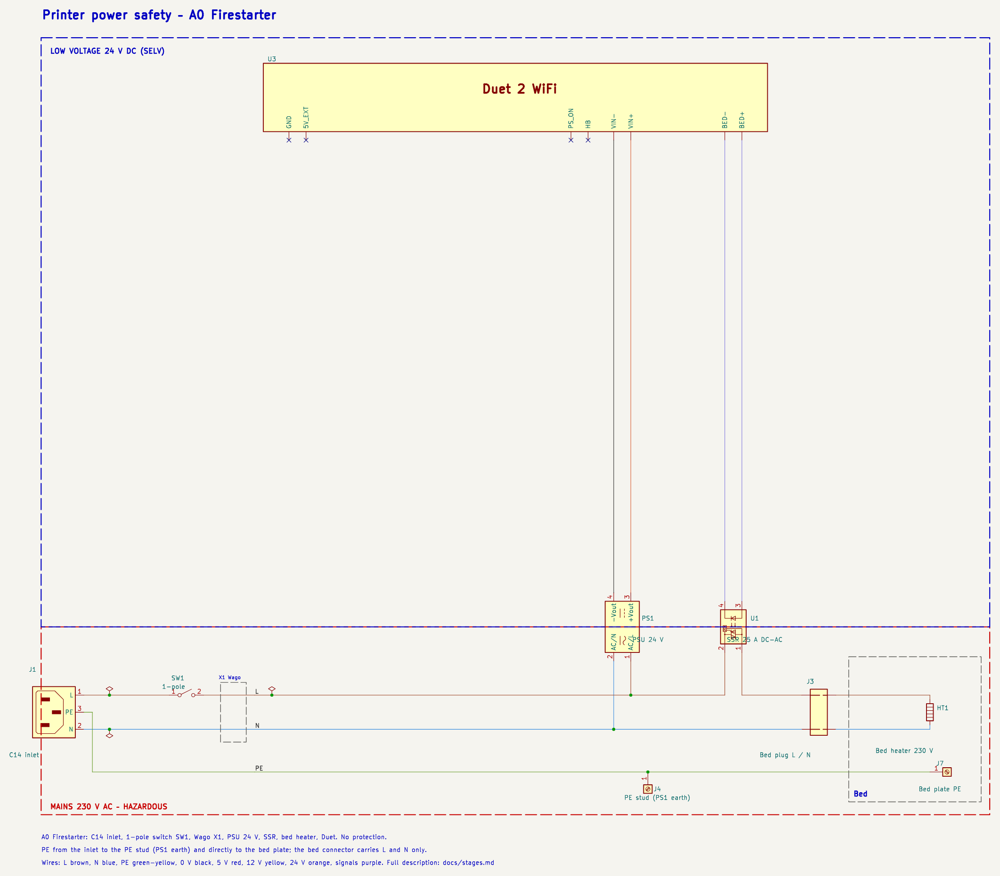
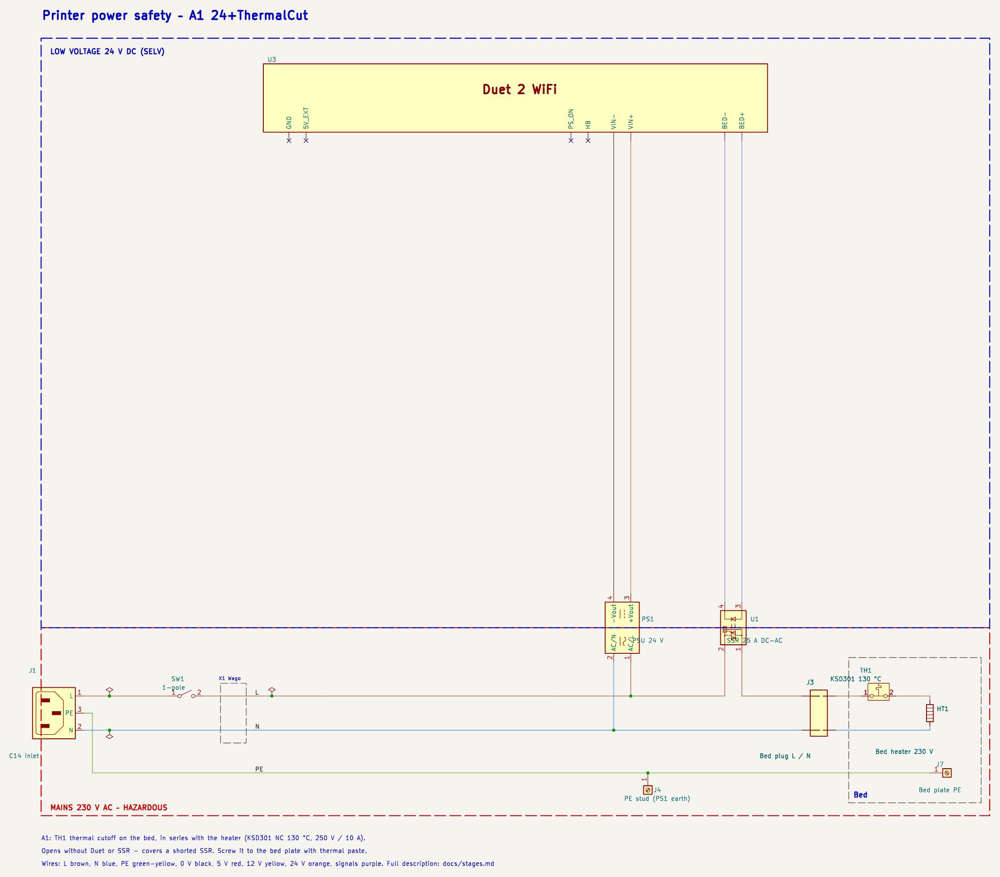
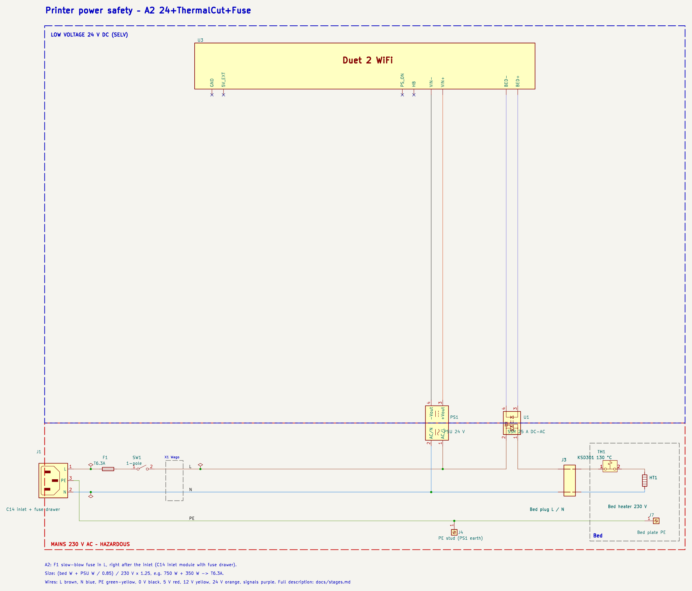
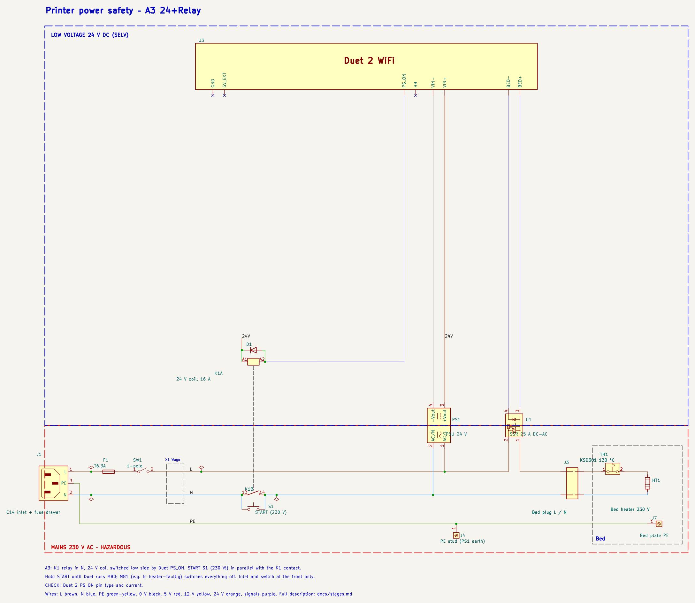
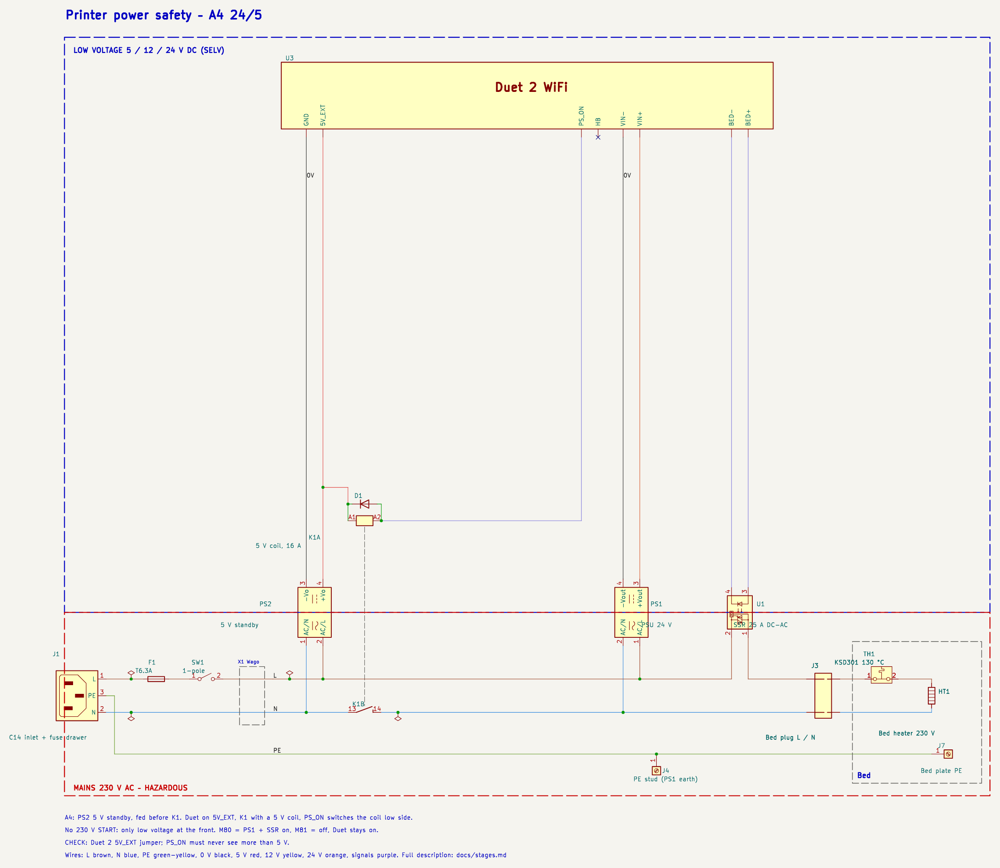
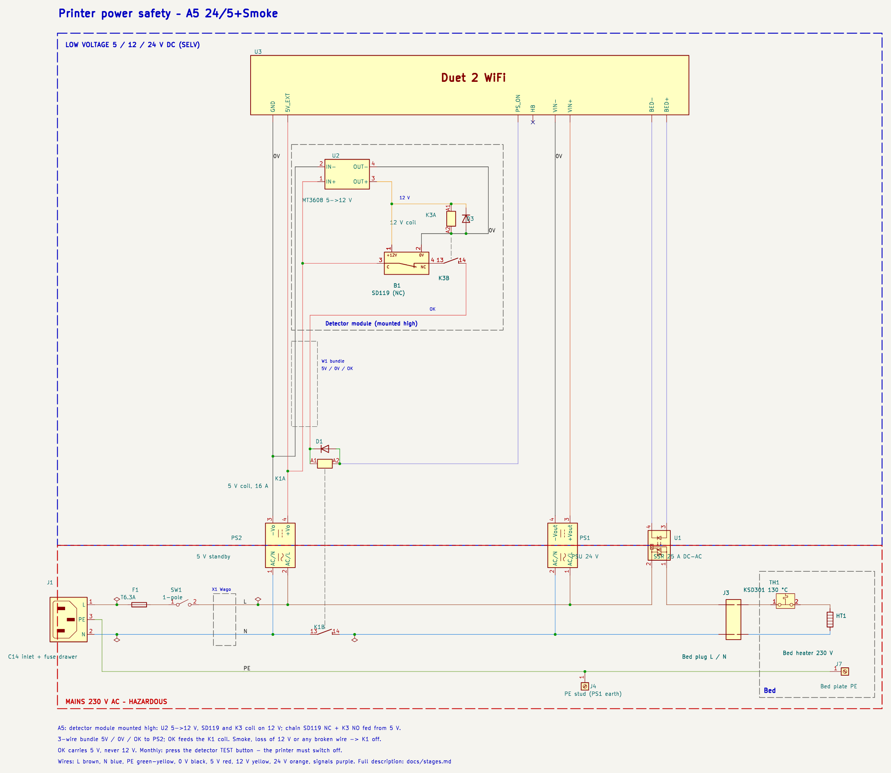
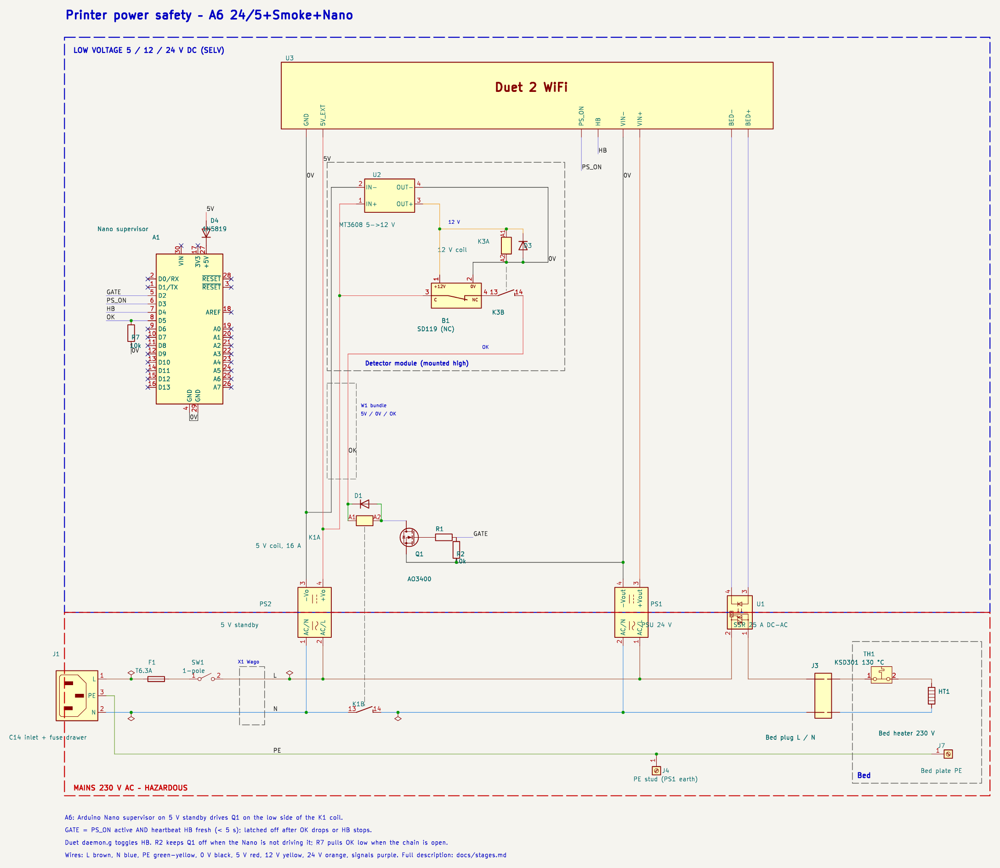

# Printer power safety – KiCad schematics and BOM per stage

What each stage adds, why, and how well it protects: [stages.md](stages.md). The schematics follow the stage sketches: mains at the bottom, low voltage above, wire colours as bought. Images: `docs/img/<code>.png`, KiCad: `kicad/steps/`.

## A0 – Firestarter

KiCad: [`A0_firestarter.kicad_sch`](../kicad/steps/A0_firestarter.kicad_sch)

- A0 Firestarter: C14 inlet, 1-pole switch SW1, Wago X1, PSU 24 V, SSR, bed heater, Duet. No protection.
- PE from the inlet to the PE stud (PS1 earth) and directly to the bed plate; the bed connector carries L and N only.

**BOM of A0**

| Ref | Part | Added | Note |
|---|---|---|---|
| J1 | IEC C14 inlet (A2+: module with fuse drawer) | A0 | – |
| SW1 | 1-pole rocker switch, near the inlet | A0 | with a reversed Schuko plug it may break N only |
| X1 | Wago lever terminals L / N (PE bypasses X1) | A0 | – |
| PS1 | PSU 24 V, class I (e.g. Mean Well LRS-350-24) | A0 | – |
| J4 | PE stud on the case, at the PS1 earth terminal | A0 | essential: insulation fault -> PE, not a live frame |
| U1 | SSR DC->AC 25 A, genuine, on heatsink | A0 | switching element, not a protection; fails shorted |
| J3 | Bed connector L / N, flexible silicone cable | A0 | – |
| HT1 | Bed heater 230 V | A0 | – |
| J7 | PE wire to the bed plate | A0 | – |
| U3 | Duet 2 WiFi | A0 | – |

## A1 – 24+ThermalCut

KiCad: [`A1_24_thermalcut.kicad_sch`](../kicad/steps/A1_24_thermalcut.kicad_sch)

- A1: TH1 thermal cutoff on the bed, in series with the heater (KSD301 NC 130 °C, 250 V / 10 A).
- Opens without Duet or SSR - covers a shorted SSR. Screw it to the bed plate with thermal paste.

**BOM of A1**

| Ref | Part | Added | Note |
|---|---|---|---|
| J1 | IEC C14 inlet (A2+: module with fuse drawer) | A0 | – |
| SW1 | 1-pole rocker switch, near the inlet | A0 | with a reversed Schuko plug it may break N only |
| X1 | Wago lever terminals L / N (PE bypasses X1) | A0 | – |
| PS1 | PSU 24 V, class I (e.g. Mean Well LRS-350-24) | A0 | – |
| J4 | PE stud on the case, at the PS1 earth terminal | A0 | essential: insulation fault -> PE, not a live frame |
| U1 | SSR DC->AC 25 A, genuine, on heatsink | A0 | switching element, not a protection; fails shorted |
| J3 | Bed connector L / N, flexible silicone cable | A0 | – |
| HT1 | Bed heater 230 V | A0 | – |
| J7 | PE wire to the bed plate | A0 | – |
| U3 | Duet 2 WiFi | A0 | – |
| TH1 | Thermal cutoff KSD301 NC 130 °C, 250 V/10 A, on the bed | A1 | independent of SSR and firmware; bimetal resets when cool |

## A2 – 24+ThermalCut+Fuse

KiCad: [`A2_24_thermalcut_fuse.kicad_sch`](../kicad/steps/A2_24_thermalcut_fuse.kicad_sch)

- A2: F1 slow-blow fuse in L, right after the inlet (C14 inlet module with fuse drawer).
- Size: (bed W + PSU W / 0.85) / 230 V x 1.25, e.g. 750 W + 350 W -> T6.3A.

**BOM of A2**

| Ref | Part | Added | Note |
|---|---|---|---|
| J1 | IEC C14 inlet (A2+: module with fuse drawer) | A0 | – |
| SW1 | 1-pole rocker switch, near the inlet | A0 | with a reversed Schuko plug it may break N only |
| X1 | Wago lever terminals L / N (PE bypasses X1) | A0 | – |
| PS1 | PSU 24 V, class I (e.g. Mean Well LRS-350-24) | A0 | – |
| J4 | PE stud on the case, at the PS1 earth terminal | A0 | essential: insulation fault -> PE, not a live frame |
| U1 | SSR DC->AC 25 A, genuine, on heatsink | A0 | switching element, not a protection; fails shorted |
| J3 | Bed connector L / N, flexible silicone cable | A0 | – |
| HT1 | Bed heater 230 V | A0 | – |
| J7 | PE wire to the bed plate | A0 | – |
| U3 | Duet 2 WiFi | A0 | – |
| TH1 | Thermal cutoff KSD301 NC 130 °C, 250 V/10 A, on the bed | A1 | independent of SSR and firmware; bimetal resets when cool |
| F1 | Fuse T6.3A 5x20 (size to load) | A2 | short circuit / overload only |

## A3 – 24+Relay

KiCad: [`A3_24_relay.kicad_sch`](../kicad/steps/A3_24_relay.kicad_sch)

- A3: K1 relay in N, 24 V coil switched low side by Duet PS_ON. START S1 (230 V!) in parallel with the K1 contact.
- Hold START until Duet runs M80; M81 (e.g. in heater-fault.g) switches everything off. Inlet and switch at the front only.
- CHECK: Duet 2 PS_ON pin type and current.

**BOM of A3**

| Ref | Part | Added | Note |
|---|---|---|---|
| J1 | IEC C14 inlet (A2+: module with fuse drawer) | A0 | – |
| SW1 | 1-pole rocker switch, near the inlet | A0 | with a reversed Schuko plug it may break N only |
| X1 | Wago lever terminals L / N (PE bypasses X1) | A0 | – |
| PS1 | PSU 24 V, class I (e.g. Mean Well LRS-350-24) | A0 | – |
| J4 | PE stud on the case, at the PS1 earth terminal | A0 | essential: insulation fault -> PE, not a live frame |
| U1 | SSR DC->AC 25 A, genuine, on heatsink | A0 | switching element, not a protection; fails shorted |
| J3 | Bed connector L / N, flexible silicone cable | A0 | – |
| HT1 | Bed heater 230 V | A0 | – |
| J7 | PE wire to the bed plate | A0 | – |
| U3 | Duet 2 WiFi | A0 | – |
| TH1 | Thermal cutoff KSD301 NC 130 °C, 250 V/10 A, on the bed | A1 | independent of SSR and firmware; bimetal resets when cool |
| F1 | Fuse T6.3A 5x20 (size to load) | A2 | short circuit / overload only |
| K1 | Relay 16 A NO, 24 V coil (e.g. G2RL-1A-E 24V) | A3 | removes 230 V from PS1 and SSR |
| S1 | START push button 1 NO, 230 V / 10 A | A3 | 230 V at the button: inlet at the front only |
| D1 | Diode 1N4148, K1 coil flyback | A3 | – |

## A4 – 24/5

KiCad: [`A4_24-5.kicad_sch`](../kicad/steps/A4_24-5.kicad_sch)

- A4: PS2 5 V standby, fed before K1. Duet on 5V_EXT, K1 with a 5 V coil, PS_ON switches the coil low side.
- No 230 V START: only low voltage at the front. M80 = PS1 + SSR on, M81 = off, Duet stays on.
- CHECK: Duet 2 5V_EXT jumper; PS_ON must never see more than 5 V.

**BOM of A4**

| Ref | Part | Added | Note |
|---|---|---|---|
| J1 | IEC C14 inlet (A2+: module with fuse drawer) | A0 | – |
| SW1 | 1-pole rocker switch, near the inlet | A0 | with a reversed Schuko plug it may break N only |
| X1 | Wago lever terminals L / N (PE bypasses X1) | A0 | – |
| PS1 | PSU 24 V, class I (e.g. Mean Well LRS-350-24) | A0 | – |
| J4 | PE stud on the case, at the PS1 earth terminal | A0 | essential: insulation fault -> PE, not a live frame |
| U1 | SSR DC->AC 25 A, genuine, on heatsink | A0 | switching element, not a protection; fails shorted |
| J3 | Bed connector L / N, flexible silicone cable | A0 | – |
| HT1 | Bed heater 230 V | A0 | – |
| J7 | PE wire to the bed plate | A0 | – |
| U3 | Duet 2 WiFi | A0 | – |
| TH1 | Thermal cutoff KSD301 NC 130 °C, 250 V/10 A, on the bed | A1 | independent of SSR and firmware; bimetal resets when cool |
| F1 | Fuse T6.3A 5x20 (size to load) | A2 | short circuit / overload only |
| K1 | Relay 16 A NO, 5 V coil (e.g. G2RL-1A-E 5V) | A4 | removes 230 V from PS1 and SSR |
| D1 | Diode 1N4148, K1 coil flyback | A3 | – |
| PS2 | PSU 5 V standby, class II (e.g. Mean Well IRM-10-5) | A4 | keeps Duet, detector and Nano alive |

## A5 – 24/5+Smoke

KiCad: [`A5_24-5_smoke.kicad_sch`](../kicad/steps/A5_24-5_smoke.kicad_sch)

- A5: detector module mounted high: U2 5->12 V, SD119 and K3 coil on 12 V; chain SD119 NC + K3 NO fed from 5 V.
- 3-wire bundle 5V / 0V / OK to PS2; OK feeds the K1 coil. Smoke, loss of 12 V or any broken wire -> K1 off.
- OK carries 5 V, never 12 V. Monthly: press the detector TEST button - the printer must switch off.

**BOM of A5**

| Ref | Part | Added | Note |
|---|---|---|---|
| J1 | IEC C14 inlet (A2+: module with fuse drawer) | A0 | – |
| SW1 | 1-pole rocker switch, near the inlet | A0 | with a reversed Schuko plug it may break N only |
| X1 | Wago lever terminals L / N (PE bypasses X1) | A0 | – |
| PS1 | PSU 24 V, class I (e.g. Mean Well LRS-350-24) | A0 | – |
| J4 | PE stud on the case, at the PS1 earth terminal | A0 | essential: insulation fault -> PE, not a live frame |
| U1 | SSR DC->AC 25 A, genuine, on heatsink | A0 | switching element, not a protection; fails shorted |
| J3 | Bed connector L / N, flexible silicone cable | A0 | – |
| HT1 | Bed heater 230 V | A0 | – |
| J7 | PE wire to the bed plate | A0 | – |
| U3 | Duet 2 WiFi | A0 | – |
| TH1 | Thermal cutoff KSD301 NC 130 °C, 250 V/10 A, on the bed | A1 | independent of SSR and firmware; bimetal resets when cool |
| F1 | Fuse T6.3A 5x20 (size to load) | A2 | short circuit / overload only |
| K1 | Relay 16 A NO, 5 V coil (e.g. G2RL-1A-E 5V) | A4 | removes 230 V from PS1 and SSR |
| D1 | Diode 1N4148, K1 coil flyback | A3 | – |
| PS2 | PSU 5 V standby, class II (e.g. Mean Well IRM-10-5) | A4 | keeps Duet, detector and Nano alive |
| B1 | Smoke detector SD119 (12 V, relay output set to NC) | A5 | any-cause fire detection; fail-safe only with K3 |
| U2 | Step-up MT3608 / XL6009 5 -> 12 V (IN- = OUT-) | A5 | detector supply |
| K3 | Relay G5V-1 12 V coil, 1 A NO | A5 | detector supply supervision |
| D3 | Diode 1N4148, K3 coil flyback | A5 | – |
| W1 | 3-wire sheathed cable 5V / 0V / OK to the module | A5 | a 5V-OK short bypasses the detector: route away from edges |

## A6 – 24/5+Smoke+Nano

KiCad: [`A6_24-5_smoke_nano.kicad_sch`](../kicad/steps/A6_24-5_smoke_nano.kicad_sch)

- A6: Arduino Nano supervisor on 5 V standby drives Q1 on the low side of the K1 coil.
- GATE = PS_ON active AND heartbeat HB fresh (< 5 s); latched off after OK drops or HB stops.
- Duet daemon.g toggles HB. R2 keeps Q1 off when the Nano is not driving it; R7 pulls OK low when the chain is open.

**BOM of A6**

| Ref | Part | Added | Note |
|---|---|---|---|
| J1 | IEC C14 inlet (A2+: module with fuse drawer) | A0 | – |
| SW1 | 1-pole rocker switch, near the inlet | A0 | with a reversed Schuko plug it may break N only |
| X1 | Wago lever terminals L / N (PE bypasses X1) | A0 | – |
| PS1 | PSU 24 V, class I (e.g. Mean Well LRS-350-24) | A0 | – |
| J4 | PE stud on the case, at the PS1 earth terminal | A0 | essential: insulation fault -> PE, not a live frame |
| U1 | SSR DC->AC 25 A, genuine, on heatsink | A0 | switching element, not a protection; fails shorted |
| J3 | Bed connector L / N, flexible silicone cable | A0 | – |
| HT1 | Bed heater 230 V | A0 | – |
| J7 | PE wire to the bed plate | A0 | – |
| U3 | Duet 2 WiFi | A0 | – |
| TH1 | Thermal cutoff KSD301 NC 130 °C, 250 V/10 A, on the bed | A1 | independent of SSR and firmware; bimetal resets when cool |
| F1 | Fuse T6.3A 5x20 (size to load) | A2 | short circuit / overload only |
| K1 | Relay 16 A NO, 5 V coil (e.g. G2RL-1A-E 5V) | A4 | removes 230 V from PS1 and SSR |
| D1 | Diode 1N4148, K1 coil flyback | A3 | – |
| PS2 | PSU 5 V standby, class II (e.g. Mean Well IRM-10-5) | A4 | keeps Duet, detector and Nano alive |
| B1 | Smoke detector SD119 (12 V, relay output set to NC) | A5 | any-cause fire detection; fail-safe only with K3 |
| U2 | Step-up MT3608 / XL6009 5 -> 12 V (IN- = OUT-) | A5 | detector supply |
| K3 | Relay G5V-1 12 V coil, 1 A NO | A5 | detector supply supervision |
| D3 | Diode 1N4148, K3 coil flyback | A5 | – |
| W1 | 3-wire sheathed cable 5V / 0V / OK to the module | A5 | a 5V-OK short bypasses the detector: route away from edges |
| A1 | Arduino Nano v3 (supervisor firmware) | A6 | watchdog + latch + diagnostics |
| Q1 | MOSFET AO3400 (logic level) | A6 | K1 coil driver |
| R1, R2 | 100 Ω gate resistor, 10 kΩ gate pull-down | A6 | Q1 off when undriven |
| R7 | 10 kΩ pull-down on the OK input | A6 | – |
| D4 | Schottky 1N5819 into the Nano 5V pin (no back-feed from USB) | A6 | – |
