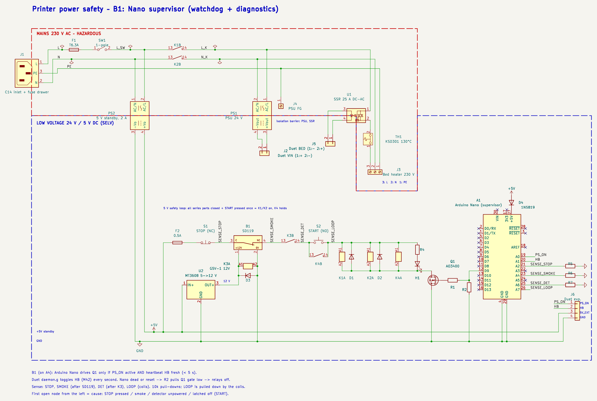
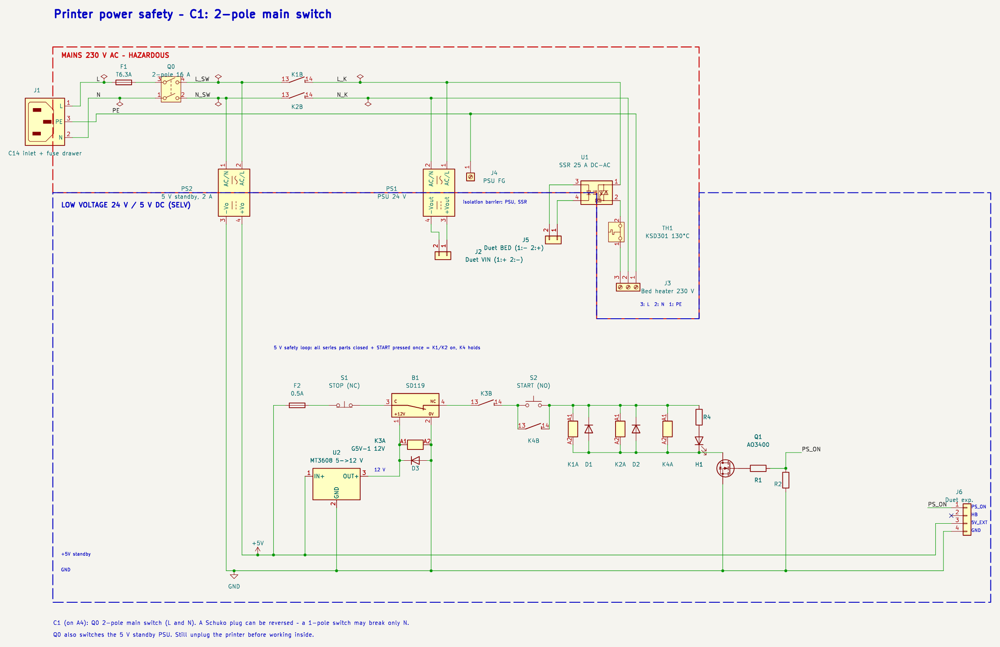
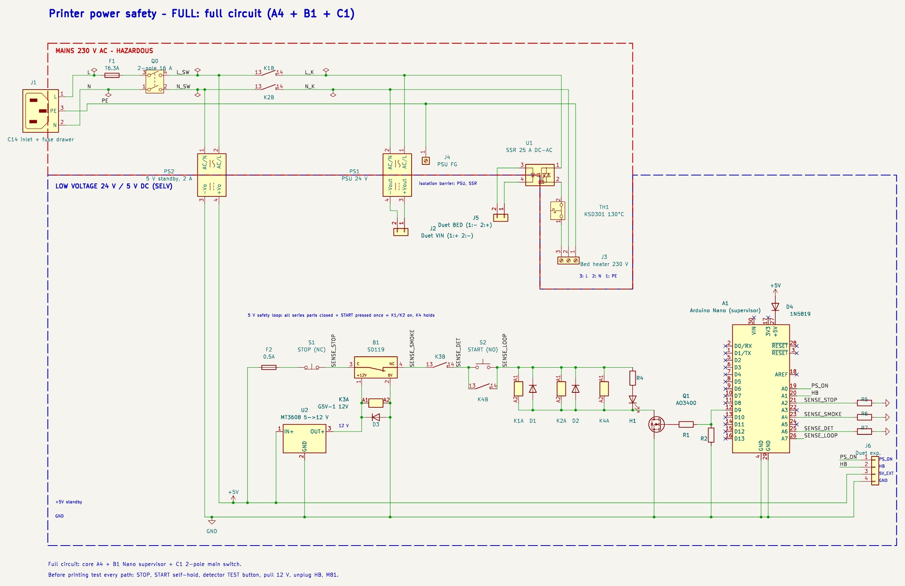

# Printer power safety – variants

**A – core:** the simplest hardware that protects against the worst faults; A0 → A4, each builds on the previous one. **B – diagnostics** and **C – service** are independent extensions of A4. Images: `docs/img/<code>.png`, KiCad: `kicad/steps/`.

```
A0 baseline ── A1 TH1 ── A2 F1 ── A3 K1/K2 + STOP + START ── A4 smoke + K3   CORE: against the worst
                                                               │
                                                               ├── B1 Nano supervisor      diagnostics
                                                               ├── C1 2-pole switch Q0     service
                                                               └── FULL = A4 + B1 + C1
```

| Fault (worst first) | Consequence | Covered by |
|---|---|---|
| SSR fails shorted | bed heats without end → fire | A1 TH1 (hardware), A3 K1/K2 (via Duet), B1 (hung Duet) |
| Fire from any other cause (PSU, wiring, hot end) | fire spreads | A4 smoke detector + K3 |
| Short circuit inside the printer | thin wires burn | A2 F1 |
| Emergency / operator sees a problem | – | A3 STOP |
| Power returns by itself after a fault (smoke clears, loose contact) | heaters restart unattended | A3 START self-hold |
| Detector unpowered | detector silently useless | A4 K3 |
| Duet hangs with heaters on | runaway not cut automatically | B1 watchdog |
| Why did it switch off? | guessing | B1 sense lines |
| Reversed Schuko plug + 1-pole switch | live parts when 'off' (service) | C1 Q0 |

Ratings (★ out of 5) say how well a part protects against the fault it is meant for – not how well the whole printer is protected.

## A0 – baseline (no protection)


KiCad: [`A0_baseline.kicad_sch`](../kicad/steps/A0_baseline.kicad_sch)

The simplest working circuit: C14 inlet, 1-pole switch, 24 V PSU, Duet, SSR and a 230 V bed heater.

Hazards of this circuit:
- **SSR fails shorted** (the most common SSR failure, frequent with counterfeit SSR-25DA): the bed heats at full power without end. Duet thermal-runaway detection can only switch the SSR input off – useless when the SSR is shorted.
- **No fuse**: the house breaker (B16) protects the building wiring, not 0.5–0.75 mm² wires inside the printer.
- **No way to cut power automatically** or by an emergency button; no fire detection.
- **1-pole switch + reversible Schuko plug**: with the plug reversed the switch breaks N; PSU, SSR and heater stay live when OFF.
- 230 V on a moving bed (cable flexing), SSR heating (≈1–1.5 W per amp, needs a heatsink), SSR off-state leakage (a few mA – the bed is live even when not heating, PE is essential).

**Rating:** – – nothing limits a fault; the circuit only works when every part works.

**BOM of A0**

| Ref | Part | Added | Protection | Opinion |
|---|---|---|---|---|
| J1 | IEC C14 inlet (with fuse: module with fuse drawer) | A0 | – | – |
| SW1 | 1-pole rocker switch | A0 | ★☆☆☆☆ | breaks only one wire; with a reversed plug that can be N |
| PS1 | PSU 24 V, class I with FG (e.g. Mean Well LRS-350-24) | A0 | – | – |
| J4 | PE to PSU case (FG) | A0 | ★★★☆☆ | essential: insulation fault -> PE instead of live frame |
| U1 | SSR DC->AC 25 A, genuine, on heatsink | A0 | – | switching element, not a protection; fails shorted |
| J3 | Bed heater 230 V, 3-wire (L, N, PE), flexible cable | A0 | – | – |
| J2, J5 | Duet 2 WiFi VIN and BED terminals | A0 | – | – |

## A1 – bed thermal cutoff


KiCad: [`A1_bed_thermal_cutoff.kicad_sch`](../kicad/steps/A1_bed_thermal_cutoff.kicad_sch)

**Why it is first:** a shorted SSR is the most likely way this printer starts a fire, and nothing in A0 can stop it. A thermal cutoff fixed to the bed, in series with the heater, opens by physics – no firmware, no SSR. One cheap part.

- Cutoff temperature ≈ 15–20 °C above the highest bed set-point (110 °C for ABS → 130 °C).
- Current rating above the heater current (750 W ≈ 3.3 A → 10 A part is fine).
- **Bimetal (KSD301)** resets when cool: with a shorted SSR the bed oscillates around 130 °C instead of running away. Survivable, but the fault is not latched. **One-shot thermal fuse** latches off (must be replaced).

**Rating:** ★★★★☆ – independent of firmware and SSR; protects only against bed overheating; a bimetal resets by itself.

**BOM of A1**

| Ref | Part | Added | Protection | Opinion |
|---|---|---|---|---|
| J1 | IEC C14 inlet (with fuse: module with fuse drawer) | A0 | – | – |
| SW1 | 1-pole rocker switch | A0 | ★☆☆☆☆ | breaks only one wire; with a reversed plug that can be N |
| PS1 | PSU 24 V, class I with FG (e.g. Mean Well LRS-350-24) | A0 | – | – |
| J4 | PE to PSU case (FG) | A0 | ★★★☆☆ | essential: insulation fault -> PE instead of live frame |
| U1 | SSR DC->AC 25 A, genuine, on heatsink | A0 | – | switching element, not a protection; fails shorted |
| J3 | Bed heater 230 V, 3-wire (L, N, PE), flexible cable | A0 | – | – |
| J2, J5 | Duet 2 WiFi VIN and BED terminals | A0 | – | – |
| TH1 | Thermal cutoff KSD301 NC 130 °C, 250 V/10 A, on the bed | A1 | ★★★★☆ | independent of SSR and firmware; auto-reset (thermal fuse = latching) |

## A2 – mains fuse


KiCad: [`A2_mains_fuse.kicad_sch`](../kicad/steps/A2_mains_fuse.kicad_sch)

**Why it is necessary:** the building breaker is sized for the house wiring (16 A). A short inside the printer – a chafed heater cable, a failed PSU input – can burn thin internal wires before a B16 trips. A fuse sized to the printer load clears it quickly.

- Slow-blow (T) because of PSU inrush current; fuse in L.
- Practical part: C14 inlet module with fuse drawer – the same module often has a 2-pole switch (→ C1 at no extra cost).
- It does **not** help with a stuck SSR: the heater current is normal, the fuse does not see a fault.

**Rating:** ★★★☆☆ – clears short circuits and overloads; does nothing against overheating at normal current (stuck SSR).

**BOM of A2**

| Ref | Part | Added | Protection | Opinion |
|---|---|---|---|---|
| J1 | IEC C14 inlet (with fuse: module with fuse drawer) | A0 | – | – |
| SW1 | 1-pole rocker switch | A0 | ★☆☆☆☆ | breaks only one wire; with a reversed plug that can be N |
| PS1 | PSU 24 V, class I with FG (e.g. Mean Well LRS-350-24) | A0 | – | – |
| J4 | PE to PSU case (FG) | A0 | ★★★☆☆ | essential: insulation fault -> PE instead of live frame |
| U1 | SSR DC->AC 25 A, genuine, on heatsink | A0 | – | switching element, not a protection; fails shorted |
| J3 | Bed heater 230 V, 3-wire (L, N, PE), flexible cable | A0 | – | – |
| J2, J5 | Duet 2 WiFi VIN and BED terminals | A0 | – | – |
| TH1 | Thermal cutoff KSD301 NC 130 °C, 250 V/10 A, on the bed | A1 | ★★★★☆ | independent of SSR and firmware; auto-reset (thermal fuse = latching) |
| F1 | Fuse T6.3A 5x20 (size to load) | A2 | ★★★☆☆ | short circuit / overload only |

## A3 – mains relays K1/K2, STOP, START self-hold


KiCad: [`A3_mains_relays_stop.kicad_sch`](../kicad/steps/A3_mains_relays_stop.kicad_sch)

**Why it is necessary:** A1 and A2 cannot remove power when something goes wrong, and A4 (smoke) needs something to switch. Two 16 A relays in L and N take 230 V off the 24 V PSU and the SSR – this also kills a stuck SSR and a failing PSU.

- **Fail-safe loop:** relays need current to stay on. A broken wire, a pressed STOP or a dead driver = power off.
- **STOP** (mushroom, latching, NC) acts directly on the coils – no software in the path.
- **START self-hold (K4):** a small relay in parallel with K1/K2 holds the loop through its own contact. After any opening (STOP, smoke, wire, Duet) the printer stays off until someone presses START at the printer – no automatic restart when smoke clears or a loose contact closes again.
- **Automatic cut:** Duet stays alive on the 5 V standby supply and switches Q1 (PS_ON). RRF calls `heater-fault.g` on thermal runaway – put `M81` there.
- **Two 1-pole relays instead of one 2-pole:** 16 A per contact, and if one contact welds the other pole still opens.
- **H1** shows the loop state; **F2** protects the 5 V loop wiring.
- Limitation: if Duet hangs with PS_ON active, nothing cuts power automatically → B1.

**Rating:** ★★★★☆ – hard-wired emergency stop and cut of ALL 230 V loads, no automatic restart; automatic cut still depends on Duet firmware.

**BOM of A3**

| Ref | Part | Added | Protection | Opinion |
|---|---|---|---|---|
| J1 | IEC C14 inlet (with fuse: module with fuse drawer) | A0 | – | – |
| SW1 | 1-pole rocker switch | A0 | ★☆☆☆☆ | breaks only one wire; with a reversed plug that can be N |
| PS1 | PSU 24 V, class I with FG (e.g. Mean Well LRS-350-24) | A0 | – | – |
| J4 | PE to PSU case (FG) | A0 | ★★★☆☆ | essential: insulation fault -> PE instead of live frame |
| U1 | SSR DC->AC 25 A, genuine, on heatsink | A0 | – | switching element, not a protection; fails shorted |
| J3 | Bed heater 230 V, 3-wire (L, N, PE), flexible cable | A0 | – | – |
| J2, J5 | Duet 2 WiFi VIN and BED terminals | A0 | – | – |
| TH1 | Thermal cutoff KSD301 NC 130 °C, 250 V/10 A, on the bed | A1 | ★★★★☆ | independent of SSR and firmware; auto-reset (thermal fuse = latching) |
| F1 | Fuse T6.3A 5x20 (size to load) | A2 | ★★★☆☆ | short circuit / overload only |
| K1, K2 | Relay Omron G2RL-1A-E 5 V coil, 16 A NO | A3 | ★★★★☆ | removes 230 V from PSU and SSR; fail-safe (needs coil current) |
| PS2 | PSU 5 V 2 A standby, class II (Mean Well IRM-10-5) | A3 | – | keeps Duet, loop and supervisor alive |
| S1 | Emergency STOP mushroom, latching, 1 NC | A3 | ★★★★☆ | hard-wired, no software in the path |
| S2, K4 | START push button 1 NO + relay G5V-1 5 V (self-hold) | A3 | ★★★★☆ | no automatic restart after any loop opening |
| F2 | Fuse 0.5 A (5 V loop) | A3 | ★★☆☆☆ | protects loop wiring |
| Q1 | MOSFET AO3400 (logic-level) + R1 100 Ω, R2 10 kΩ pull-down | A3 | ★★★☆☆ | loop driver; pull-down = off when undriven |
| D1, D2 | Diode 1N4148 (coil flyback, shared by K1/K2/K4) | A3 | – | – |
| H1, R4 | LED + 330 Ω (loop closed) | A3 | ★☆☆☆☆ | indication only |
| J6 | Duet 5V_EXT / GND / PS_ON / HB (expansion header) | A3 | – | – |

## A4 – smoke detector SD119 + supply supervision K3


KiCad: [`A4_smoke_detector.kicad_sch`](../kicad/steps/A4_smoke_detector.kicad_sch)

**Why it belongs to the core:** A1 watches only the bed. A fire can also start in the PSU, the wiring, the SSR, the hot end or the filament. A smoke detector reacts to all of them and its contact drops the relays directly.

- 12 V from a small step-up (MT3608) on the 5 V standby rail – the detector works whenever the printer is plugged in.
- **Why K3 comes with it, not later:** the detector's relay is energised only in alarm. Without supply (dead step-up, loose wire) its NC contact stays closed for ever – the loop looks fine and a fire would not cut the power. K3 is held on by the same 12 V, so a missing supply opens the loop. A detector without K3 is not worth fitting.
- K3: small 12 V signal relay (G5V-1, 1 A contact – the loop current is ≈ 0.25 A), D3 flyback diode.
- Still not covered: a powered detector whose sensor is dead. Use the TEST button regularly.

**Core complete after A4:** two independent hardware paths remove heater power (TH1 on the bed; K1/K2 via the loop), the loop is fail-safe (STOP, smoke, detector supply, broken wire), it does not restart by itself, and the 230 V side is fused. No software in the safety path except the automatic cut by Duet (PS_ON).

**Rating:** ★★★★☆ – fire from any cause cuts power without software; fail-safe on detector supply loss; late (smoke) detection.

**BOM of A4**

| Ref | Part | Added | Protection | Opinion |
|---|---|---|---|---|
| J1 | IEC C14 inlet (with fuse: module with fuse drawer) | A0 | – | – |
| SW1 | 1-pole rocker switch | A0 | ★☆☆☆☆ | breaks only one wire; with a reversed plug that can be N |
| PS1 | PSU 24 V, class I with FG (e.g. Mean Well LRS-350-24) | A0 | – | – |
| J4 | PE to PSU case (FG) | A0 | ★★★☆☆ | essential: insulation fault -> PE instead of live frame |
| U1 | SSR DC->AC 25 A, genuine, on heatsink | A0 | – | switching element, not a protection; fails shorted |
| J3 | Bed heater 230 V, 3-wire (L, N, PE), flexible cable | A0 | – | – |
| J2, J5 | Duet 2 WiFi VIN and BED terminals | A0 | – | – |
| TH1 | Thermal cutoff KSD301 NC 130 °C, 250 V/10 A, on the bed | A1 | ★★★★☆ | independent of SSR and firmware; auto-reset (thermal fuse = latching) |
| F1 | Fuse T6.3A 5x20 (size to load) | A2 | ★★★☆☆ | short circuit / overload only |
| K1, K2 | Relay Omron G2RL-1A-E 5 V coil, 16 A NO | A3 | ★★★★☆ | removes 230 V from PSU and SSR; fail-safe (needs coil current) |
| PS2 | PSU 5 V 2 A standby, class II (Mean Well IRM-10-5) | A3 | – | keeps Duet, loop and supervisor alive |
| S1 | Emergency STOP mushroom, latching, 1 NC | A3 | ★★★★☆ | hard-wired, no software in the path |
| S2, K4 | START push button 1 NO + relay G5V-1 5 V (self-hold) | A3 | ★★★★☆ | no automatic restart after any loop opening |
| F2 | Fuse 0.5 A (5 V loop) | A3 | ★★☆☆☆ | protects loop wiring |
| Q1 | MOSFET AO3400 (logic-level) + R1 100 Ω, R2 10 kΩ pull-down | A3 | ★★★☆☆ | loop driver; pull-down = off when undriven |
| D1, D2 | Diode 1N4148 (coil flyback, shared by K1/K2/K4) | A3 | – | – |
| H1, R4 | LED + 330 Ω (loop closed) | A3 | ★☆☆☆☆ | indication only |
| J6 | Duet 5V_EXT / GND / PS_ON / HB (expansion header) | A3 | – | – |
| B1 | Smoke detector SD119 (12 V, relay C-NC) | A4 | ★★★★☆ | any-cause fire detection; fail-safe only together with K3 |
| U2 | Step-up MT3608 5 -> 12 V | A4 | – | detector supply |
| K3 | Relay G5V-1 12 V coil, 1 A NO + D3 1N4148 | A4 | ★★★★★ | detector supply supervision; makes B1 fail-safe |

## B1 – Nano supervisor (watchdog + diagnostics) (extension of A4)



KiCad: [`B1_supervisor.kicad_sch`](../kicad/steps/B1_supervisor.kicad_sch)

**Why it is an extension, not core:** the core already cuts power in hardware for STOP, smoke and broken wires. B1 adds two things: an independent watchdog for a hung Duet (in A3/A4 a frozen Duet with PS_ON active keeps the heaters powered) and diagnostics – which part opened the loop.

Options considered:
- **74HC123 retriggerable monostable** – no firmware, very robust, but no diagnostics. Good minimal watchdog.
- **Arduino Nano (chosen)** – watchdog on HB + PS_ON, reads four loop nodes, can report to Duet, room for an independent bed thermistor. 5 V logic matches the loop.
- **ESP32** – Wi-Fi alerts and logging, but 3.3 V, more complex, more ways to fail.
- **Safety relay (e.g. Pilz PNOZ)** – certified, monitors contacts, but costly and oversized for a hobby printer.

- Fail-safe: Q1 needs an active high gate from the Nano; R2 holds it low during reset or when the Nano is missing.
- D4 stops the Nano's USB 5 V from feeding the standby rail.
- Option (not drawn): second NTC on the bed read by the Nano → independent over-temperature cut-off.

**Rating:** ★★★★☆ – independent of Duet; catches a hung controller; tells why the loop opened; fails in the safe direction.

**BOM of B1**

| Ref | Part | Added | Protection | Opinion |
|---|---|---|---|---|
| J1 | IEC C14 inlet (with fuse: module with fuse drawer) | A0 | – | – |
| SW1 | 1-pole rocker switch | A0 | ★☆☆☆☆ | breaks only one wire; with a reversed plug that can be N |
| PS1 | PSU 24 V, class I with FG (e.g. Mean Well LRS-350-24) | A0 | – | – |
| J4 | PE to PSU case (FG) | A0 | ★★★☆☆ | essential: insulation fault -> PE instead of live frame |
| U1 | SSR DC->AC 25 A, genuine, on heatsink | A0 | – | switching element, not a protection; fails shorted |
| J3 | Bed heater 230 V, 3-wire (L, N, PE), flexible cable | A0 | – | – |
| J2, J5 | Duet 2 WiFi VIN and BED terminals | A0 | – | – |
| TH1 | Thermal cutoff KSD301 NC 130 °C, 250 V/10 A, on the bed | A1 | ★★★★☆ | independent of SSR and firmware; auto-reset (thermal fuse = latching) |
| F1 | Fuse T6.3A 5x20 (size to load) | A2 | ★★★☆☆ | short circuit / overload only |
| K1, K2 | Relay Omron G2RL-1A-E 5 V coil, 16 A NO | A3 | ★★★★☆ | removes 230 V from PSU and SSR; fail-safe (needs coil current) |
| PS2 | PSU 5 V 2 A standby, class II (Mean Well IRM-10-5) | A3 | – | keeps Duet, loop and supervisor alive |
| S1 | Emergency STOP mushroom, latching, 1 NC | A3 | ★★★★☆ | hard-wired, no software in the path |
| S2, K4 | START push button 1 NO + relay G5V-1 5 V (self-hold) | A3 | ★★★★☆ | no automatic restart after any loop opening |
| F2 | Fuse 0.5 A (5 V loop) | A3 | ★★☆☆☆ | protects loop wiring |
| Q1 | MOSFET AO3400 (logic-level) + R1 100 Ω, R2 10 kΩ pull-down | A3 | ★★★☆☆ | loop driver; pull-down = off when undriven |
| D1, D2 | Diode 1N4148 (coil flyback, shared by K1/K2/K4) | A3 | – | – |
| H1, R4 | LED + 330 Ω (loop closed) | A3 | ★☆☆☆☆ | indication only |
| J6 | Duet 5V_EXT / GND / PS_ON / HB (expansion header) | A3 | – | – |
| B1 | Smoke detector SD119 (12 V, relay C-NC) | A4 | ★★★★☆ | any-cause fire detection; fail-safe only together with K3 |
| U2 | Step-up MT3608 5 -> 12 V | A4 | – | detector supply |
| K3 | Relay G5V-1 12 V coil, 1 A NO + D3 1N4148 | A4 | ★★★★★ | detector supply supervision; makes B1 fail-safe |
| A1 | Arduino Nano v3 (supervisor firmware) | B1 | ★★★★☆ | independent watchdog + diagnostics; dies safe |
| R5..R7 | 10 kΩ pull-downs on sense inputs STOP, SMOKE, DET | B1 | – | – |
| D4 | Schottky 1N5819 into Nano 5V pin (no back-feed from USB) | B1 | – | – |

## C1 – 2-pole main switch (extension of A4)



KiCad: [`C1_two_pole_switch.kicad_sch`](../kicad/steps/C1_two_pole_switch.kicad_sch)

**Why it is an extension:** it protects the person servicing the printer, not against a fault while printing. After A3 the relays already break L and N of the PSU and the SSR; what stays live behind a 1-pole switch with a reversed plug is the inlet wiring, F1 and the 5 V standby PSU.

- A Schuko plug fits both ways. A 1-pole switch in the wire that happens to be N leaves everything at 230 V when 'off'.
- 16 A rated rocker or the inlet module's built-in 2-pole switch (often in the same part as F1).
- It is a manual isolator, not an automatic protection.

**Rating:** ★★★☆☆ – service safety with a reversible plug; manual only, no fault protection.

**BOM of C1**

| Ref | Part | Added | Protection | Opinion |
|---|---|---|---|---|
| J1 | IEC C14 inlet (with fuse: module with fuse drawer) | A0 | – | – |
| PS1 | PSU 24 V, class I with FG (e.g. Mean Well LRS-350-24) | A0 | – | – |
| J4 | PE to PSU case (FG) | A0 | ★★★☆☆ | essential: insulation fault -> PE instead of live frame |
| U1 | SSR DC->AC 25 A, genuine, on heatsink | A0 | – | switching element, not a protection; fails shorted |
| J3 | Bed heater 230 V, 3-wire (L, N, PE), flexible cable | A0 | – | – |
| J2, J5 | Duet 2 WiFi VIN and BED terminals | A0 | – | – |
| TH1 | Thermal cutoff KSD301 NC 130 °C, 250 V/10 A, on the bed | A1 | ★★★★☆ | independent of SSR and firmware; auto-reset (thermal fuse = latching) |
| F1 | Fuse T6.3A 5x20 (size to load) | A2 | ★★★☆☆ | short circuit / overload only |
| K1, K2 | Relay Omron G2RL-1A-E 5 V coil, 16 A NO | A3 | ★★★★☆ | removes 230 V from PSU and SSR; fail-safe (needs coil current) |
| PS2 | PSU 5 V 2 A standby, class II (Mean Well IRM-10-5) | A3 | – | keeps Duet, loop and supervisor alive |
| S1 | Emergency STOP mushroom, latching, 1 NC | A3 | ★★★★☆ | hard-wired, no software in the path |
| S2, K4 | START push button 1 NO + relay G5V-1 5 V (self-hold) | A3 | ★★★★☆ | no automatic restart after any loop opening |
| F2 | Fuse 0.5 A (5 V loop) | A3 | ★★☆☆☆ | protects loop wiring |
| Q1 | MOSFET AO3400 (logic-level) + R1 100 Ω, R2 10 kΩ pull-down | A3 | ★★★☆☆ | loop driver; pull-down = off when undriven |
| D1, D2 | Diode 1N4148 (coil flyback, shared by K1/K2/K4) | A3 | – | – |
| H1, R4 | LED + 330 Ω (loop closed) | A3 | ★☆☆☆☆ | indication only |
| J6 | Duet 5V_EXT / GND / PS_ON / HB (expansion header) | A3 | – | – |
| B1 | Smoke detector SD119 (12 V, relay C-NC) | A4 | ★★★★☆ | any-cause fire detection; fail-safe only together with K3 |
| U2 | Step-up MT3608 5 -> 12 V | A4 | – | detector supply |
| K3 | Relay G5V-1 12 V coil, 1 A NO + D3 1N4148 | A4 | ★★★★★ | detector supply supervision; makes B1 fail-safe |
| Q0 | Main switch 2-pole 16 A (replaces SW1) | C1 | ★★★☆☆ | manual isolation of L and N |

## FULL – full circuit (A4 + B1 + C1)



KiCad: [`FULL_full.kicad_sch`](../kicad/steps/FULL_full.kicad_sch)

All protections together. Remaining before building: verify the Duet 5V_EXT / PS_ON details, use a genuine SSR on a heatsink, a flexible strain-relieved bed cable, and test every path (STOP, START self-hold, TEST button, pull 12 V, unplug HB, M81) before printing.

**Rating:** – – core protections plus watchdog, diagnostics and 2-pole isolation.

**BOM of FULL**

| Ref | Part | Added | Protection | Opinion |
|---|---|---|---|---|
| J1 | IEC C14 inlet (with fuse: module with fuse drawer) | A0 | – | – |
| PS1 | PSU 24 V, class I with FG (e.g. Mean Well LRS-350-24) | A0 | – | – |
| J4 | PE to PSU case (FG) | A0 | ★★★☆☆ | essential: insulation fault -> PE instead of live frame |
| U1 | SSR DC->AC 25 A, genuine, on heatsink | A0 | – | switching element, not a protection; fails shorted |
| J3 | Bed heater 230 V, 3-wire (L, N, PE), flexible cable | A0 | – | – |
| J2, J5 | Duet 2 WiFi VIN and BED terminals | A0 | – | – |
| TH1 | Thermal cutoff KSD301 NC 130 °C, 250 V/10 A, on the bed | A1 | ★★★★☆ | independent of SSR and firmware; auto-reset (thermal fuse = latching) |
| F1 | Fuse T6.3A 5x20 (size to load) | A2 | ★★★☆☆ | short circuit / overload only |
| K1, K2 | Relay Omron G2RL-1A-E 5 V coil, 16 A NO | A3 | ★★★★☆ | removes 230 V from PSU and SSR; fail-safe (needs coil current) |
| PS2 | PSU 5 V 2 A standby, class II (Mean Well IRM-10-5) | A3 | – | keeps Duet, loop and supervisor alive |
| S1 | Emergency STOP mushroom, latching, 1 NC | A3 | ★★★★☆ | hard-wired, no software in the path |
| S2, K4 | START push button 1 NO + relay G5V-1 5 V (self-hold) | A3 | ★★★★☆ | no automatic restart after any loop opening |
| F2 | Fuse 0.5 A (5 V loop) | A3 | ★★☆☆☆ | protects loop wiring |
| Q1 | MOSFET AO3400 (logic-level) + R1 100 Ω, R2 10 kΩ pull-down | A3 | ★★★☆☆ | loop driver; pull-down = off when undriven |
| D1, D2 | Diode 1N4148 (coil flyback, shared by K1/K2/K4) | A3 | – | – |
| H1, R4 | LED + 330 Ω (loop closed) | A3 | ★☆☆☆☆ | indication only |
| J6 | Duet 5V_EXT / GND / PS_ON / HB (expansion header) | A3 | – | – |
| B1 | Smoke detector SD119 (12 V, relay C-NC) | A4 | ★★★★☆ | any-cause fire detection; fail-safe only together with K3 |
| U2 | Step-up MT3608 5 -> 12 V | A4 | – | detector supply |
| K3 | Relay G5V-1 12 V coil, 1 A NO + D3 1N4148 | A4 | ★★★★★ | detector supply supervision; makes B1 fail-safe |
| A1 | Arduino Nano v3 (supervisor firmware) | B1 | ★★★★☆ | independent watchdog + diagnostics; dies safe |
| R5..R7 | 10 kΩ pull-downs on sense inputs STOP, SMOKE, DET | B1 | – | – |
| D4 | Schottky 1N5819 into Nano 5V pin (no back-feed from USB) | B1 | – | – |
| Q0 | Main switch 2-pole 16 A (replaces SW1) | C1 | ★★★☆☆ | manual isolation of L and N |
