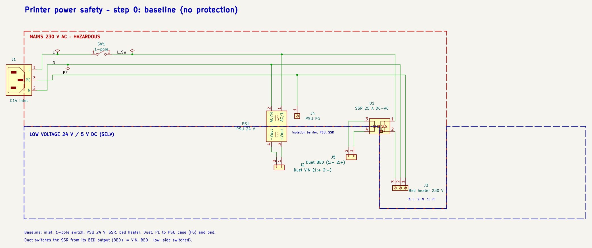
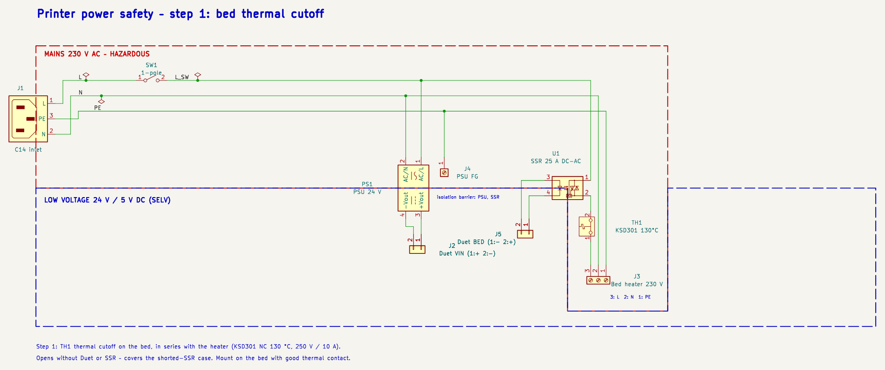
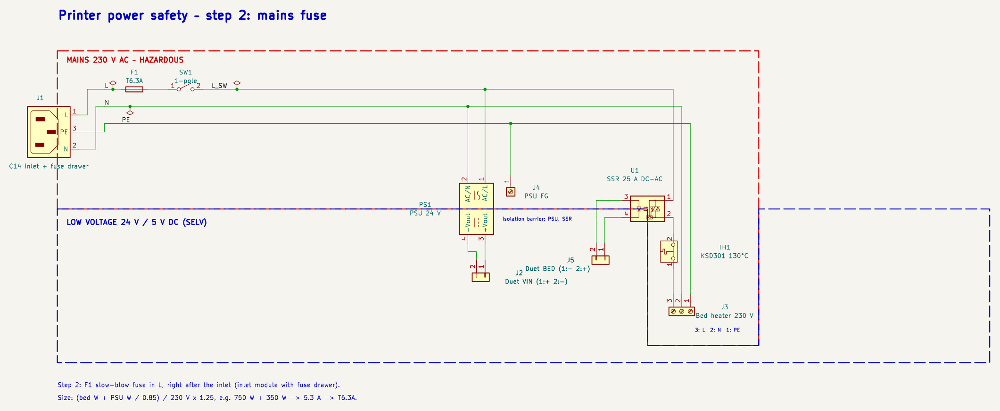
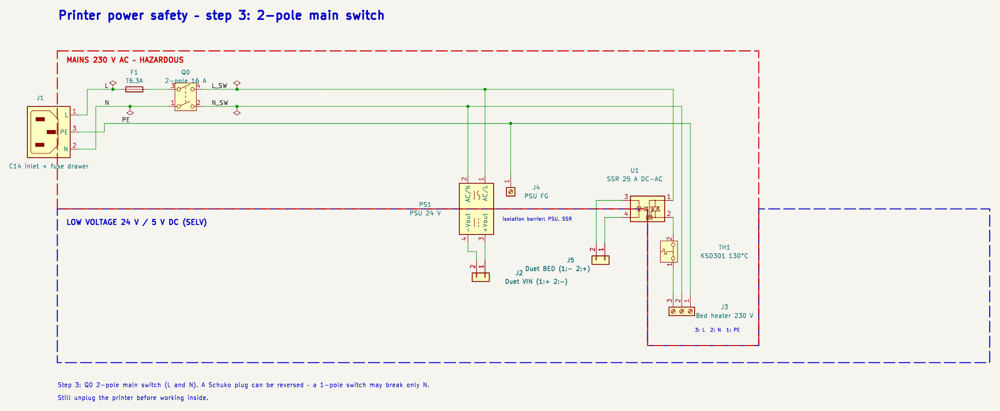
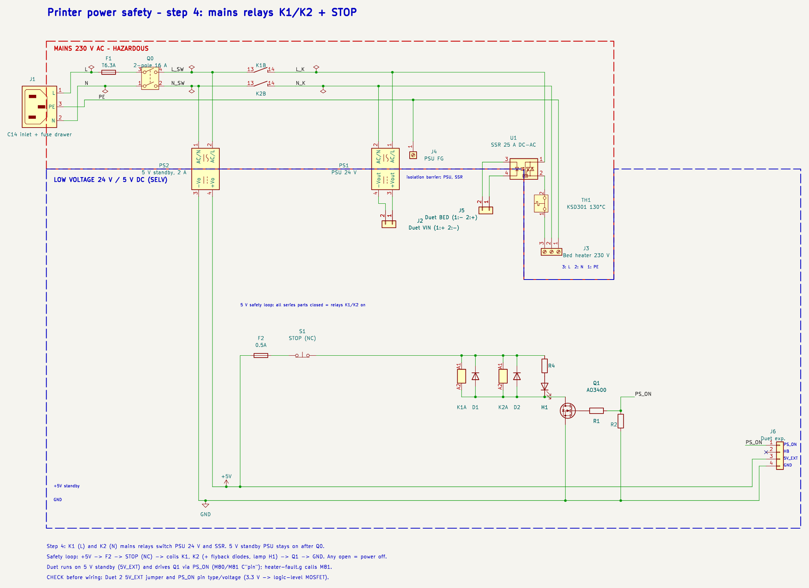
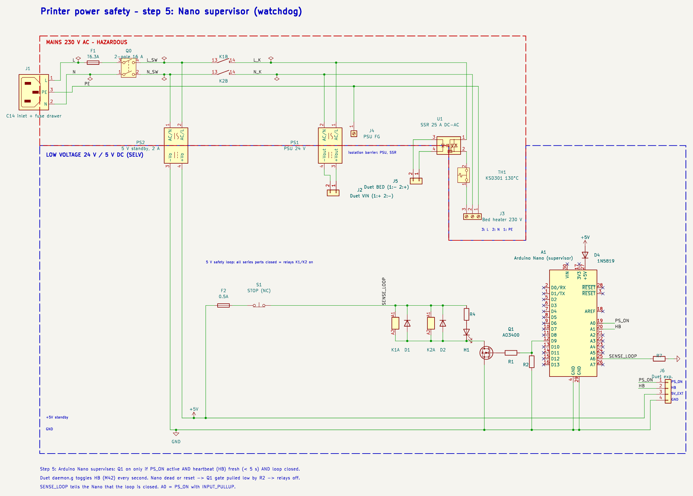
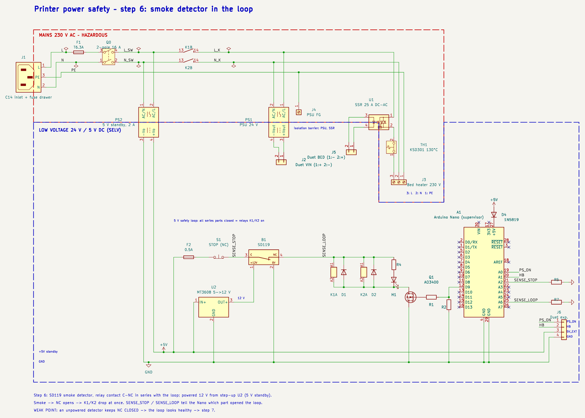
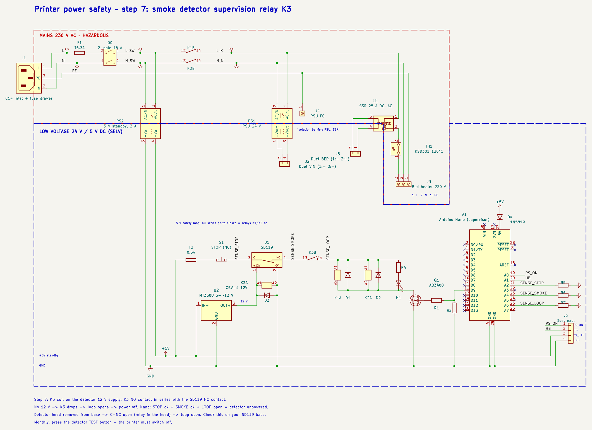

# Printer power safety – step by step

Each step adds one protection to the previous schematic. Images: `docs/img/stepN.png`, KiCad: `kicad/steps/`.
Ratings (★ out of 5) say how well a part protects against the fault it is meant for – not how well the whole printer is protected.

## Step 0 – baseline (no protection)

KiCad: [`step0_baseline.kicad_sch`](../kicad/steps/step0_baseline.kicad_sch)

The simplest working circuit: C14 inlet, 1-pole switch, 24 V PSU, Duet, SSR and a 230 V bed heater.

Hazards of this circuit:
- **SSR fails shorted** (the most common SSR failure, frequent with counterfeit SSR-25DA): the bed heats at full power without end. Duet thermal-runaway detection can only switch the SSR input off – useless when the SSR is shorted.
- **No fuse**: the house breaker (B16) protects the building wiring, not 0.5–0.75 mm² wires inside the printer.
- **1-pole switch + reversible Schuko plug**: with the plug reversed the switch breaks N; PSU, SSR and heater stay live when OFF.
- **No way to cut power automatically** or by an emergency button; no fire detection.
- 230 V on a moving bed (cable flexing), SSR heating (≈1–1.5 W per amp, needs a heatsink), SSR off-state leakage (a few mA – the bed is live even when not heating, PE is essential).

**Rating:** – – nothing limits a fault; the circuit only works when every part works.

**BOM after step 0**

| Ref | Part | Added | Protection | Opinion |
|---|---|---|---|---|
| J1 | IEC C14 inlet (from step 2: module with fuse drawer) | 0 | – | – |
| SW1 | 1-pole rocker switch | 0 | ★☆☆☆☆ | breaks only one wire; with a reversed plug that can be N |
| PS1 | PSU 24 V, class I with FG (e.g. Mean Well LRS-350-24) | 0 | – | – |
| J4 | PE to PSU case (FG) | 0 | ★★★☆☆ | essential: insulation fault -> PE instead of live frame |
| U1 | SSR DC->AC 25 A, genuine, on heatsink | 0 | – | switching element, not a protection; fails shorted |
| J3 | Bed heater 230 V, 3-wire (L, N, PE), flexible cable | 0 | – | – |
| J2, J5 | Duet 2 WiFi VIN and BED terminals | 0 | – | – |

## Step 1 – bed thermal cutoff

KiCad: [`step1_bed_thermal_cutoff.kicad_sch`](../kicad/steps/step1_bed_thermal_cutoff.kicad_sch)

**Why it is necessary:** a shorted SSR is the most likely and most dangerous fault, and nothing in the baseline can stop it. A thermal cutoff fixed to the bed, in series with the heater, opens by physics – no firmware, no SSR.

- Cutoff temperature ≈ 15–20 °C above the highest bed set-point (110 °C for ABS → 130 °C).
- Current rating above the heater current (750 W ≈ 3.3 A → 10 A part is fine).
- **Bimetal (KSD301)** resets when cool: with a shorted SSR the bed oscillates around 130 °C instead of running away. Survivable, but the fault is not latched. **One-shot thermal fuse** latches off (must be replaced). Later steps (K1/K2 relays, supervisor) add the latching cut-off, so a bimetal is enough here.

**Rating:** ★★★★☆ – independent of firmware and SSR; protects only against bed overheating; a bimetal resets by itself.

**BOM after step 1**

| Ref | Part | Added | Protection | Opinion |
|---|---|---|---|---|
| J1 | IEC C14 inlet (from step 2: module with fuse drawer) | 0 | – | – |
| SW1 | 1-pole rocker switch | 0 | ★☆☆☆☆ | breaks only one wire; with a reversed plug that can be N |
| PS1 | PSU 24 V, class I with FG (e.g. Mean Well LRS-350-24) | 0 | – | – |
| J4 | PE to PSU case (FG) | 0 | ★★★☆☆ | essential: insulation fault -> PE instead of live frame |
| U1 | SSR DC->AC 25 A, genuine, on heatsink | 0 | – | switching element, not a protection; fails shorted |
| J3 | Bed heater 230 V, 3-wire (L, N, PE), flexible cable | 0 | – | – |
| J2, J5 | Duet 2 WiFi VIN and BED terminals | 0 | – | – |
| TH1 | Thermal cutoff KSD301 NC 130 °C, 250 V/10 A, on the bed | 1 | ★★★★☆ | independent of SSR and firmware; auto-reset (thermal fuse = latching) |

## Step 2 – mains fuse

KiCad: [`step2_mains_fuse.kicad_sch`](../kicad/steps/step2_mains_fuse.kicad_sch)

**Why it is necessary:** the building breaker is sized for the house wiring (16 A). A short inside the printer – a chafed heater cable, a failed PSU input – can burn thin internal wires before a B16 trips. A fuse sized to the printer load clears it quickly.

- Slow-blow (T) because of PSU inrush current; fuse in L (after step 3 the 2-pole switch also isolates N).
- Practical part: C14 inlet module with fuse drawer (often with a 2-pole switch → step 3 in the same part).
- It does **not** help with a stuck SSR: the heater current is normal, the fuse does not see a fault.

**Rating:** ★★★☆☆ – clears short circuits and overloads; does nothing against overheating at normal current (stuck SSR).

**BOM after step 2**

| Ref | Part | Added | Protection | Opinion |
|---|---|---|---|---|
| J1 | IEC C14 inlet (from step 2: module with fuse drawer) | 0 | – | – |
| SW1 | 1-pole rocker switch | 0 | ★☆☆☆☆ | breaks only one wire; with a reversed plug that can be N |
| PS1 | PSU 24 V, class I with FG (e.g. Mean Well LRS-350-24) | 0 | – | – |
| J4 | PE to PSU case (FG) | 0 | ★★★☆☆ | essential: insulation fault -> PE instead of live frame |
| U1 | SSR DC->AC 25 A, genuine, on heatsink | 0 | – | switching element, not a protection; fails shorted |
| J3 | Bed heater 230 V, 3-wire (L, N, PE), flexible cable | 0 | – | – |
| J2, J5 | Duet 2 WiFi VIN and BED terminals | 0 | – | – |
| TH1 | Thermal cutoff KSD301 NC 130 °C, 250 V/10 A, on the bed | 1 | ★★★★☆ | independent of SSR and firmware; auto-reset (thermal fuse = latching) |
| F1 | Fuse T6.3A 5x20 (size to load) | 2 | ★★★☆☆ | short circuit / overload only |

## Step 3 – 2-pole main switch

KiCad: [`step3_two_pole_switch.kicad_sch`](../kicad/steps/step3_two_pole_switch.kicad_sch)

**Why it is necessary:** a Schuko plug fits both ways. With a 1-pole switch in the wire that happens to be N, the PSU input, the SSR and the bed stay at 230 V when the printer is 'off'. A 2-pole switch breaks both wires regardless of plug orientation.

- 16 A rated rocker or the inlet module's built-in 2-pole switch.
- It is a manual isolator, not an automatic protection.

**Rating:** ★★★☆☆ – service safety with a reversible plug; manual only, no fault protection.

**BOM after step 3**

| Ref | Part | Added | Protection | Opinion |
|---|---|---|---|---|
| J1 | IEC C14 inlet (from step 2: module with fuse drawer) | 0 | – | – |
| PS1 | PSU 24 V, class I with FG (e.g. Mean Well LRS-350-24) | 0 | – | – |
| J4 | PE to PSU case (FG) | 0 | ★★★☆☆ | essential: insulation fault -> PE instead of live frame |
| U1 | SSR DC->AC 25 A, genuine, on heatsink | 0 | – | switching element, not a protection; fails shorted |
| J3 | Bed heater 230 V, 3-wire (L, N, PE), flexible cable | 0 | – | – |
| J2, J5 | Duet 2 WiFi VIN and BED terminals | 0 | – | – |
| TH1 | Thermal cutoff KSD301 NC 130 °C, 250 V/10 A, on the bed | 1 | ★★★★☆ | independent of SSR and firmware; auto-reset (thermal fuse = latching) |
| F1 | Fuse T6.3A 5x20 (size to load) | 2 | ★★★☆☆ | short circuit / overload only |
| Q0 | Main switch 2-pole 16 A | 3 | ★★★☆☆ | manual isolation of L and N |

## Step 4 – mains relays K1/K2 + STOP

KiCad: [`step4_mains_relays_stop.kicad_sch`](../kicad/steps/step4_mains_relays_stop.kicad_sch)

**Why it is worth it:** the first three steps cannot remove power when something goes wrong. Two 16 A relays in L and N take 230 V off the 24 V PSU and the SSR – this also kills a stuck SSR and a failing PSU.

- **Fail-safe loop:** relays need current to stay on. A broken wire, a pressed STOP or a dead driver = power off.
- **STOP** (mushroom, latching, NC) acts directly on the coils – no software in the path.
- **Automatic cut:** Duet stays alive on the 5 V standby supply and switches Q1 (PS_ON). RRF calls `heater-fault.g` on thermal runaway – put `M81` there, and in `daemon.g` checks if wanted.
- **Two 1-pole relays instead of one 2-pole:** 16 A per contact, and if one contact welds the other pole still opens.
- **H1** shows the loop state; **F2** protects the 5 V loop wiring.
- Limitation: if Duet hangs with PS_ON active, nothing cuts power automatically → step 5.

**Rating:** ★★★★☆ – hard-wired emergency stop and automatic cut of ALL 230 V loads; automatic action still depends on Duet firmware.

**BOM after step 4**

| Ref | Part | Added | Protection | Opinion |
|---|---|---|---|---|
| J1 | IEC C14 inlet (from step 2: module with fuse drawer) | 0 | – | – |
| PS1 | PSU 24 V, class I with FG (e.g. Mean Well LRS-350-24) | 0 | – | – |
| J4 | PE to PSU case (FG) | 0 | ★★★☆☆ | essential: insulation fault -> PE instead of live frame |
| U1 | SSR DC->AC 25 A, genuine, on heatsink | 0 | – | switching element, not a protection; fails shorted |
| J3 | Bed heater 230 V, 3-wire (L, N, PE), flexible cable | 0 | – | – |
| J2, J5 | Duet 2 WiFi VIN and BED terminals | 0 | – | – |
| TH1 | Thermal cutoff KSD301 NC 130 °C, 250 V/10 A, on the bed | 1 | ★★★★☆ | independent of SSR and firmware; auto-reset (thermal fuse = latching) |
| F1 | Fuse T6.3A 5x20 (size to load) | 2 | ★★★☆☆ | short circuit / overload only |
| Q0 | Main switch 2-pole 16 A | 3 | ★★★☆☆ | manual isolation of L and N |
| K1, K2 | Relay Omron G2RL-1A-E 5 V coil, 16 A NO | 4 | ★★★★☆ | removes 230 V from PSU and SSR; fail-safe (needs coil current) |
| PS2 | PSU 5 V 2 A standby, class II (Mean Well IRM-10-5) | 4 | – | keeps Duet, loop and supervisor alive |
| S1 | Emergency STOP mushroom, latching, 1 NC | 4 | ★★★★☆ | hard-wired, no software in the path |
| F2 | Fuse 0.5 A (5 V loop) | 4 | ★★☆☆☆ | protects loop wiring |
| Q1 | MOSFET AO3400 (logic-level) + R1 100 Ω, R2 10 kΩ pull-down | 4 | ★★★☆☆ | loop driver; pull-down = off when undriven |
| D1, D2 | Diode 1N4148 (coil flyback) | 4 | – | – |
| H1, R4 | LED + 330 Ω (loop closed) | 4 | ★☆☆☆☆ | indication only |
| J6 | Duet 5V_EXT / GND / PS_ON / HB (expansion header) | 4 | – | – |

## Step 5 – Nano supervisor (watchdog)

KiCad: [`step5_supervisor.kicad_sch`](../kicad/steps/step5_supervisor.kicad_sch)

**Why it is worth it:** in step 4 the automatic cut relies on Duet firmware. A frozen Duet with PS_ON active keeps the heaters powered. An independent supervisor closes that gap.

Options considered:
- **74HC123 retriggerable monostable** – no firmware, very robust, but no diagnostics. Good minimal choice.
- **Arduino Nano (chosen)** – watchdog on HB + PS_ON, reads the loop sense lines (which part opened the loop), can latch off until a reset button, room for an independent bed thermistor (A7) later. 5 V logic matches the loop.
- **ESP32** – Wi-Fi alerts and logging, but 3.3 V, more complex, more ways to fail.
- **Safety relay (e.g. Pilz PNOZ)** – certified, monitors contacts, but costly and oversized for a hobby printer.

- Fail-safe: Q1 needs an active high gate from the Nano; R2 holds it low during reset or when the Nano is missing.
- Option (not drawn): second NTC on the bed read by the Nano → independent over-temperature cut-off.

**Rating:** ★★★★☆ – independent of Duet; catches a hung controller; its own firmware fails in the safe direction (no drive = off).

**BOM after step 5**

| Ref | Part | Added | Protection | Opinion |
|---|---|---|---|---|
| J1 | IEC C14 inlet (from step 2: module with fuse drawer) | 0 | – | – |
| PS1 | PSU 24 V, class I with FG (e.g. Mean Well LRS-350-24) | 0 | – | – |
| J4 | PE to PSU case (FG) | 0 | ★★★☆☆ | essential: insulation fault -> PE instead of live frame |
| U1 | SSR DC->AC 25 A, genuine, on heatsink | 0 | – | switching element, not a protection; fails shorted |
| J3 | Bed heater 230 V, 3-wire (L, N, PE), flexible cable | 0 | – | – |
| J2, J5 | Duet 2 WiFi VIN and BED terminals | 0 | – | – |
| TH1 | Thermal cutoff KSD301 NC 130 °C, 250 V/10 A, on the bed | 1 | ★★★★☆ | independent of SSR and firmware; auto-reset (thermal fuse = latching) |
| F1 | Fuse T6.3A 5x20 (size to load) | 2 | ★★★☆☆ | short circuit / overload only |
| Q0 | Main switch 2-pole 16 A | 3 | ★★★☆☆ | manual isolation of L and N |
| K1, K2 | Relay Omron G2RL-1A-E 5 V coil, 16 A NO | 4 | ★★★★☆ | removes 230 V from PSU and SSR; fail-safe (needs coil current) |
| PS2 | PSU 5 V 2 A standby, class II (Mean Well IRM-10-5) | 4 | – | keeps Duet, loop and supervisor alive |
| S1 | Emergency STOP mushroom, latching, 1 NC | 4 | ★★★★☆ | hard-wired, no software in the path |
| F2 | Fuse 0.5 A (5 V loop) | 4 | ★★☆☆☆ | protects loop wiring |
| Q1 | MOSFET AO3400 (logic-level) + R1 100 Ω, R2 10 kΩ pull-down | 4 | ★★★☆☆ | loop driver; pull-down = off when undriven |
| D1, D2 | Diode 1N4148 (coil flyback) | 4 | – | – |
| H1, R4 | LED + 330 Ω (loop closed) | 4 | ★☆☆☆☆ | indication only |
| J6 | Duet 5V_EXT / GND / PS_ON / HB (expansion header) | 4 | – | – |
| A1 | Arduino Nano v3 (supervisor firmware) | 5 | ★★★★☆ | independent watchdog; dies safe |
| R5..R7 | 10 kΩ pull-downs on sense inputs (added with each sense line) | 5 | – | – |
| D4 | Schottky 1N5819 into Nano 5V pin (no back-feed from USB) | 5 | – | – |

## Step 6 – smoke detector in the loop

KiCad: [`step6_smoke_detector.kicad_sch`](../kicad/steps/step6_smoke_detector.kicad_sch)

**Why it is worth it:** thermal protections watch the bed only. A smoke detector reacts to fire from any cause – wiring, PSU, hot end, filament. Its NC contact in the loop drops the relays directly.

- 12 V from a small step-up (MT3608) on the 5 V standby rail – the detector works whenever the printer is plugged in.
- Sense lines let the Nano report the cause (STOP pressed vs. smoke).
- **Fail-unsafe:** the detector's relay is energised only in alarm. Without supply (dead step-up, loose wire) the NC contact stays closed for ever – the loop looks fine and fire would not cut the power.

**Rating:** ★★★☆☆ – detects fire from any cause and cuts power without software; late detection; FAIL-UNSAFE when unpowered.

**BOM after step 6**

| Ref | Part | Added | Protection | Opinion |
|---|---|---|---|---|
| J1 | IEC C14 inlet (from step 2: module with fuse drawer) | 0 | – | – |
| PS1 | PSU 24 V, class I with FG (e.g. Mean Well LRS-350-24) | 0 | – | – |
| J4 | PE to PSU case (FG) | 0 | ★★★☆☆ | essential: insulation fault -> PE instead of live frame |
| U1 | SSR DC->AC 25 A, genuine, on heatsink | 0 | – | switching element, not a protection; fails shorted |
| J3 | Bed heater 230 V, 3-wire (L, N, PE), flexible cable | 0 | – | – |
| J2, J5 | Duet 2 WiFi VIN and BED terminals | 0 | – | – |
| TH1 | Thermal cutoff KSD301 NC 130 °C, 250 V/10 A, on the bed | 1 | ★★★★☆ | independent of SSR and firmware; auto-reset (thermal fuse = latching) |
| F1 | Fuse T6.3A 5x20 (size to load) | 2 | ★★★☆☆ | short circuit / overload only |
| Q0 | Main switch 2-pole 16 A | 3 | ★★★☆☆ | manual isolation of L and N |
| K1, K2 | Relay Omron G2RL-1A-E 5 V coil, 16 A NO | 4 | ★★★★☆ | removes 230 V from PSU and SSR; fail-safe (needs coil current) |
| PS2 | PSU 5 V 2 A standby, class II (Mean Well IRM-10-5) | 4 | – | keeps Duet, loop and supervisor alive |
| S1 | Emergency STOP mushroom, latching, 1 NC | 4 | ★★★★☆ | hard-wired, no software in the path |
| F2 | Fuse 0.5 A (5 V loop) | 4 | ★★☆☆☆ | protects loop wiring |
| Q1 | MOSFET AO3400 (logic-level) + R1 100 Ω, R2 10 kΩ pull-down | 4 | ★★★☆☆ | loop driver; pull-down = off when undriven |
| D1, D2 | Diode 1N4148 (coil flyback) | 4 | – | – |
| H1, R4 | LED + 330 Ω (loop closed) | 4 | ★☆☆☆☆ | indication only |
| J6 | Duet 5V_EXT / GND / PS_ON / HB (expansion header) | 4 | – | – |
| A1 | Arduino Nano v3 (supervisor firmware) | 5 | ★★★★☆ | independent watchdog; dies safe |
| R5..R7 | 10 kΩ pull-downs on sense inputs (added with each sense line) | 5 | – | – |
| D4 | Schottky 1N5819 into Nano 5V pin (no back-feed from USB) | 5 | – | – |
| B1 | Smoke detector SD119 (12 V, relay C-NC) | 6 | ★★★☆☆ | any-cause fire detection; fail-unsafe alone |
| U2 | Step-up MT3608 5 -> 12 V | 6 | – | detector supply |

## Step 7 – smoke detector supervision relay K3

KiCad: [`step7_smoke_supervision.kicad_sch`](../kicad/steps/step7_smoke_supervision.kicad_sch)

**Why it is necessary:** it closes the fail-unsafe gap from step 6. K3 sits in the loop and is held on only by the same 12 V that powers the detector. Any loss of that supply opens the loop.

- K3: small 12 V signal relay (G5V-1, 1 A contact – the loop current is ≈ 0.2 A), D3 flyback diode.
- **Presence check by the Nano** (the alternative you suggested) is included: SENSE_SMOKE is the node between SD119 and K3. STOP ok, SMOKE ok, LOOP open → detector unpowered; SMOKE open → smoke (or head removed).
- Still not covered: a powered detector whose sensor is dead. Use the TEST button regularly.

**Overall after step 7:** two independent hardware paths remove heater power (TH1 on the bed; K1/K2 via the loop), the loop is fail-safe (STOP, smoke, detector supply, supervisor, broken wire), and the 230 V side is fused and isolated with a 2-pole switch. Remaining: verify Duet 5V_EXT / PS_ON details, use a genuine SSR on a heatsink, flexible strain-relieved bed cable, and test every path (STOP, TEST button, unplug HB, pull 12 V) before printing.

**Rating:** ★★★★★ – makes the detector fail-safe: no detector supply = loop open; Nano can tell the cause.

**BOM after step 7**

| Ref | Part | Added | Protection | Opinion |
|---|---|---|---|---|
| J1 | IEC C14 inlet (from step 2: module with fuse drawer) | 0 | – | – |
| PS1 | PSU 24 V, class I with FG (e.g. Mean Well LRS-350-24) | 0 | – | – |
| J4 | PE to PSU case (FG) | 0 | ★★★☆☆ | essential: insulation fault -> PE instead of live frame |
| U1 | SSR DC->AC 25 A, genuine, on heatsink | 0 | – | switching element, not a protection; fails shorted |
| J3 | Bed heater 230 V, 3-wire (L, N, PE), flexible cable | 0 | – | – |
| J2, J5 | Duet 2 WiFi VIN and BED terminals | 0 | – | – |
| TH1 | Thermal cutoff KSD301 NC 130 °C, 250 V/10 A, on the bed | 1 | ★★★★☆ | independent of SSR and firmware; auto-reset (thermal fuse = latching) |
| F1 | Fuse T6.3A 5x20 (size to load) | 2 | ★★★☆☆ | short circuit / overload only |
| Q0 | Main switch 2-pole 16 A | 3 | ★★★☆☆ | manual isolation of L and N |
| K1, K2 | Relay Omron G2RL-1A-E 5 V coil, 16 A NO | 4 | ★★★★☆ | removes 230 V from PSU and SSR; fail-safe (needs coil current) |
| PS2 | PSU 5 V 2 A standby, class II (Mean Well IRM-10-5) | 4 | – | keeps Duet, loop and supervisor alive |
| S1 | Emergency STOP mushroom, latching, 1 NC | 4 | ★★★★☆ | hard-wired, no software in the path |
| F2 | Fuse 0.5 A (5 V loop) | 4 | ★★☆☆☆ | protects loop wiring |
| Q1 | MOSFET AO3400 (logic-level) + R1 100 Ω, R2 10 kΩ pull-down | 4 | ★★★☆☆ | loop driver; pull-down = off when undriven |
| D1, D2 | Diode 1N4148 (coil flyback) | 4 | – | – |
| H1, R4 | LED + 330 Ω (loop closed) | 4 | ★☆☆☆☆ | indication only |
| J6 | Duet 5V_EXT / GND / PS_ON / HB (expansion header) | 4 | – | – |
| A1 | Arduino Nano v3 (supervisor firmware) | 5 | ★★★★☆ | independent watchdog; dies safe |
| R5..R7 | 10 kΩ pull-downs on sense inputs (added with each sense line) | 5 | – | – |
| D4 | Schottky 1N5819 into Nano 5V pin (no back-feed from USB) | 5 | – | – |
| B1 | Smoke detector SD119 (12 V, relay C-NC) | 6 | ★★★☆☆ | any-cause fire detection; fail-unsafe alone |
| U2 | Step-up MT3608 5 -> 12 V | 6 | – | detector supply |
| K3 | Relay G5V-1 12 V coil, 1 A NO + D3 1N4148 | 7 | ★★★★★ | detector supply supervision; makes B1 fail-safe |
