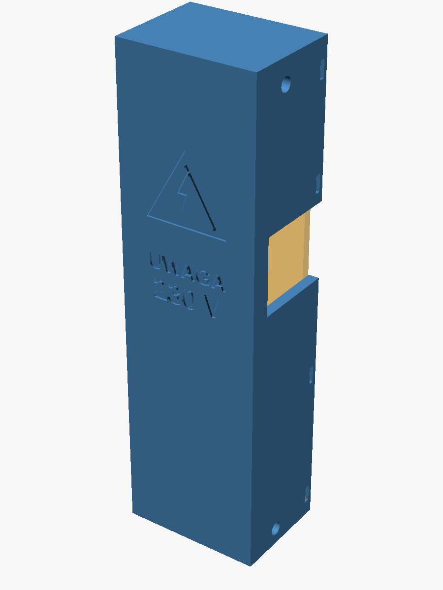

# Mains module enclosure – draft v4

> **Work in progress.** Draft version: dimensions, mounting and cable entries will change.
> More enclosures will be added. Check the date and version before printing.
>
> *Wersja robocza – będzie modyfikowana.*

Holds the **230 V parts**: relays K1 and K2 (separated by a rib) and the 5 V standby PSU.
Outer size 40 × 30 × 140.8 mm. The flat cap sits recessed in the body: 4 tabs on the left
in slots of the left wall, 2 × M3 screws on the right into heat-set inserts. The outer wall
carries a raised "UWAGA 230 V" warning (Polish: "CAUTION 230 V").

It is screwed (2 × M3, heat-set inserts) to the right wall of an existing printer
power-switch / SSR enclosure (`PowerSwitch-SSR-Mount.stl`), top flush. That enclosure is a
third-party model and is **not included**; the cable passage and two screw holes are cut
into it by `part = "old"` in the SCAD file.

| File | What |
|---|---|
| `body_print.stl`, `cap_print.stl` | ready to print, in print orientation |
| `modul_korpus.step`, `modul_pokrywa.step` | body and cap as STEP (B-rep), in the coordinates of the old enclosure |
| `modul_230V.scad` | OpenSCAD source; `part` = `body`, `cap`, `module`, `body_print`, `cap_print`; `assembly` / `old` need the third-party STL |
| `modul_230V_step.py` | STEP / FreeCAD export of the same geometry: `freecadcmd modul_230V_step.py` |
| `module.png`, `body.png` | previews |

Print in a flame-retardant material if you can (PC or PC-ABS V0, at least PETG – not PLA).
A 3D-printed box is not a certified mains enclosure.
